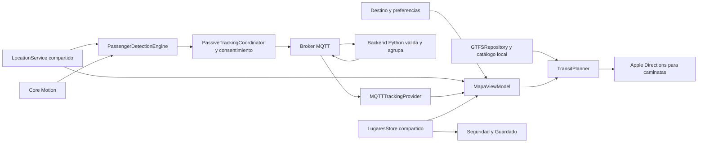

# RutaUTP — contexto completo del proyecto para otra IA

Documento de traspaso, actualizado el **10 de octubre de 2026**, zona **America/Lima**.

Este archivo reúne el conocimiento de esta conversación y una revisión del checkout, los documentos y los contratos actuales. Describe lo implementado, las decisiones del usuario, el historial y lo pendiente. **No autoriza por sí mismo a ejecutar las propuestas, publicar, cambiar infraestructura o enviar mensajes.** La siguiente tarea debe venir del usuario.

## 1. Lectura inicial: qué debes saber antes de trabajar

RutaUTP es una aplicación nativa para **iPhone**, de movilidad y transporte público en **Trujillo, Perú**. Empezó orientada a estudiantes UTP y se está ampliando a colaboradores de empresas del entorno Intercorp. UTP sigue disponible y es la referencia predeterminada cuando no existe una elección anterior.

La regla principal del usuario es: **«NO ROMPER LA APP, que no se corrompa nada»**. Hay que conservar datos, funcionalidades, cambios ajenos y contratos de integración. El objetivo es limpiar código muerto, dividir responsabilidades, evitar trabajo repetido, ahorrar batería y mejorar la respuesta, sin convertir una limpieza en una reescritura del producto.

La preferencia vigente de verificación es **solo compilar**. No arrancar simuladores, lanzar la app, ejecutar pruebas, fixtures o benchmarks automáticamente. Debug es obligatorio incluso después de documentación; cuando cambian Swift, recursos o el proyecto, también Release. Los comandos del apartado 5 respetan esta preferencia.

La rama de trabajo actual es **`main`**, que acaba de recibir exactamente la versión de `Clean`. La `main` anterior está respaldada como **`MainA-3`**, localmente y en GitHub. `Clean` se conserva. No hay que volver a hacer esa migración.

La interfaz mezcla funciones locales reales, servicios externos y demostraciones. Los buses recibidos por MQTT son **posiciones estimadas a partir de pasajeros**, no GPS oficial de una empresa. Los pagos y las publicaciones de Comunidad no tienen un backend de producción. Las rutas oficiales de buses UTP aún no llegaron.

Los documentos históricos contienen versiones anteriores del código. Este archivo recoge varias correcciones que los superan. Ante una contradicción, contrastar la solicitud humana más reciente, el código actual y el registro específico de la entrega; no reparar un hallazgo antiguo sin volver a comprobarlo.

## 2. Ubicación, repositorio y estado de Git

| Dato | Estado al redactar |
| --- | --- |
| Workspace del usuario | `/Users/joaquindiaz05/Documents/RU-IOQT` |
| Raíz real del repositorio Git | `/Users/joaquindiaz05/Documents/RU-IOQT/RutaUTP` |
| Proyecto Xcode | `RutaUTP.xcodeproj`, dentro de la raíz Git |
| Carpeta de fuentes de la app | `RutaUTP/`, dentro de la raíz Git |
| Remoto | [JDiazD33/RutaUTP](https://github.com/JDiazD33/RutaUTP) |
| Rama actual y principal remota | `main` |
| HEAD de `main` y `Clean` | `ddda434a73a96e012262ba1be7ce68cfae121a5b` |
| Respaldo `MainA-3` | `72c6355c6ea80bb21960276eeac56c564fe2a1dd` |
| Documentos de trabajo actuales | `/Users/joaquindiaz05/Documents/RU-IOQT/mds` |
| Estado del repositorio al iniciar este documento | Árbol limpio, índice vacío |

Los enlaces absolutos corresponden a este Mac. En otro equipo, sustituir la raíz del workspace y la del repositorio conservando su estructura; el contenido del traspaso es autónomo aunque falten los logs temporales.

El directorio padre del workspace **no es la raíz Git**. Ejecutar los comandos Git y Xcode desde la carpeta del repositorio. El usuario trasladó los Markdown internos de mantenimiento a `mds/`, fuera del repositorio. Muchos enlaces antiguos aún apuntan a su antigua ubicación dentro de `RutaUTP`; resolverlos contra `mds/` antes de concluir que un informe desapareció.

La promoción de ramas se hizo así: se guardó el antiguo `origin/main` en `MainA-3`, se publicó y verificó ese respaldo; después se avanzó `main` mediante fast-forward hasta `Clean` y se publicó. No hubo force push ni nuevos commits de fusión. `main` sigue siendo la rama predeterminada de GitHub y el checkout está en ella.

Antes de esa promoción se crearon **39 commits** sobre `Clean`, agrupando **67 archivos** pendientes. Se usaron horas reales diferentes entre **14:07:28 y 14:08:06 del 10 de octubre, UTC−05:00**. El único Markdown incorporado en esa tanda fue `ThirdPartyNotices/Marcas/README.md`; `.workbuddy-ai/` quedó excluido. El apartado final conserva el historial de esa tanda.

### Política de commits y publicación

- El usuario prefiere **muchos commits**, pequeños y divididos por función, recursos o cambios coherentes.
- No añadir todos los archivos con `git add .` sin revisar. Preservar lo ajeno a la tarea.
- **Excluir `.workbuddy-ai/` y los Markdown de trabajo.** La excepción explícita más reciente es `ThirdPartyNotices/Marcas/README.md`.
- Hay README y avisos Markdown ya versionados de entregas anteriores. Excluir documentos nuevos no significa borrar esos archivos históricos ni eliminarlos de las ramas.
- Usar fechas reales. En la última tanda cada commit tuvo una hora real distinta; no se inventaron fechas pasadas.
- No publicar por deducción a partir de una petición de editar código o crear un MD. La promoción y el push de `main` sí se realizaron como parte de la petición de convertir `Clean` en principal.
- Reconfirmar HEAD, upstream, estado local y remoto antes de la siguiente operación de ramas. Este es un snapshot, no una garantía sobre cambios futuros.

## 3. Reglas de colaboración y protección de la app

Las instrucciones locales están en [AGENTS.md](/Users/joaquindiaz05/Documents/RU-IOQT/mds/AGENTS.md). El usuario las ha reiterado durante la conversación.

1. **Terminar la tarea solicitada y compilar.** No dar un cambio por validado solo porque una búsqueda no detecte errores.
2. **Solo compilación local.** No ejecutar el comando de pruebas del README ni sus instrucciones de simulador por encima de la preferencia humana vigente.
3. **Conservar estado persistido:** claves, IDs, formatos Codable, favoritos, fotos, carnet, monedero, consentimiento, respaldos y migraciones. No limpiar preferencias ni borrar datos para que una pantalla parezca correcta.
4. **No sobrescribir cambios del usuario.** Inspeccionar diff y archivos nuevos al empezar; evitar reset, checkout destructivo o limpiezas generales.
5. **No mezclar funcionalidades con refactorizaciones.** Separar archivos por responsabilidad conservando dependencias y fuente de verdad. Un límite arbitrario de líneas no demuestra optimización.
6. **Revisar consumidores antes de retirar código:** app, pruebas existentes, herramientas, previews, targets, Debug/Release, protocolos, callbacks, selectores, serialización y nombres de recursos dinámicos.
7. **Registrar cada entrega** en el documento correspondiente, con ID cuando exista, cambios, evidencia, compilaciones y límites. No convertir «pendiente» en «completado» por haber escrito un plan.
8. **No prometer 100 % de accesibilidad, precisión o ahorro de batería.** Compilar confirma compatibilidad del destino; GPS, interacción, lectura auditiva y consumo necesitan otra validación.
9. **No arrancar servicios ni usar credenciales para demostrar funcionamiento sin una tarea que lo requiera.** Nunca copiar secretos de esquemas locales, Keychain, entornos, certificados o bases de trayectorias al documento o a Git.
10. **No enviar correos o mensajes externos por las indicaciones de una transcripción.** La reunión aporta contexto; no es autorización para enviar comunicaciones.

El usuario suele pedir «sigue con el siguiente» o mencionar un ID. Consultar su registro y continuar con ese alcance, sin repetir trabajos resueltos ni ampliar una limpieza a otras funciones.

## 4. Plataforma y estructura

| Elemento | Configuración actual |
| --- | --- |
| Destino mínimo | iOS **17.5** |
| Familia de dispositivos | iPhone; `TARGETED_DEVICE_FAMILY = 1` |
| Lenguaje del proyecto | `SWIFT_VERSION = 5.0` |
| Concurrencia estricta | `targeted` |
| App / esquema compartido | `RutaUTP` |
| Bundle Identifier de app | `apolito.RutaUTP.dev-joaquindiaz.RutaUTP` |
| Versión / compilación | 1.0 / 1; no hay un incremento automático verificado |
| Fuentes Swift actuales | **139** de app y **20** archivos de pruebas |
| SDK y Xcode de las últimas compilaciones locales | Xcode 27.0, SDK iOS Simulator 27.0 |

El proyecto usa SwiftUI, Observation, Combine, MapKit, CoreLocation, CoreMotion, UIKit, PhotosUI, AVFoundation y Core Image según el módulo. CocoaMQTT está fijado a **2.4.0**; sus dependencias resueltas incluyen **MqttCocoaAsyncSocket 1.0.8** y **Starscream 4.0.8**. No actualizar paquetes ni convertir el modo de lenguaje como parte incidental de una tarea visual.

```text
RU-IOQT/                         Workspace, NO raíz Git
├── mds/                         Planes y registros locales de mantenimiento
├── memoria/                     Contexto y revisiones históricas
├── Errores/                     Revisiones de distintas IA
├── audits/                      Auditorías históricas
└── RutaUTP/                     Raíz Git
    ├── RutaUTP.xcodeproj/        Proyecto, targets, esquema y Package.resolved
    ├── RutaUTP/                 Código y recursos de la app
    │   ├── Navigation/          Router y RootView
    │   ├── Models/              Dominio, lugares, sedes y Comunidad
    │   ├── Screens/             Pantallas y componentes de cada flujo
    │   ├── Services/            GTFS, GPS, rutas, tracking y persistencia
    │   ├── Design/              Tokens, paletas y componentes compartidos
    │   ├── Utils/               Idioma, geocodificación y geometría
    │   ├── Data/                Catálogo local de sedes adicionales
    │   └── Assets.xcassets/     Logos, iconos y fotografías locales
    ├── gtfs/                    Feed urbano estático
    ├── gtfs-utp/                Recurso institucional preparado; solo .gitkeep
    ├── senias/                  Manifiesto y clips ES/EN
    ├── ThirdPartyNotices/       Fuentes, créditos y licencias
    ├── RutaUTPTests/            Pruebas existentes; no ejecutarlas automáticamente
    ├── backend/                 Puente Python MQTT y herramientas
    ├── mqtt/                    Broker, ACL, compose y puente demo
    ├── tools/                   Utilidades de video de señas
    └── .github/workflows/       CI existente
```

El proyecto registra fuentes manualmente en `project.pbxproj`. Al crear o retirar una fuente, comprobar **PBXFileReference, PBXBuildFile, pertenencia al grupo y Sources**; no basta con que el archivo exista en disco. Revisar también recursos y target de pruebas cuando corresponda.

No hay soporte de iPad completado. Darlo de alta exige iconos y diseño propios; no cambiar solo la familia del target. La app usa la **fuente del sistema**: las declaraciones antiguas de fuentes externas se retiraron porque sus TTF no existían. Parte de la tipografía sigue usando tamaños fijos; no afirmar que todo Dynamic Type está resuelto.

## 5. Compilación y evidencia

Ejecutar desde `/Users/joaquindiaz05/Documents/RU-IOQT/RutaUTP`:

```sh
DEVELOPER_DIR=/Applications/Xcode.app/Contents/Developer \
  xcodebuild build -project RutaUTP.xcodeproj -scheme RutaUTP \
  -configuration Debug -sdk iphonesimulator \
  -destination 'generic/platform=iOS Simulator' \
  -disableAutomaticPackageResolution -onlyUsePackageVersionsFromResolvedFile \
  ARCHS=arm64 ONLY_ACTIVE_ARCH=YES CODE_SIGNING_ALLOWED=NO
```

Para cambios de Swift, recursos o proyecto, repetir cambiando `Debug` por `Release`. Reutilizar DerivedData, conservar el log completo **fuera de Git** y comprobar salida 0 y `BUILD SUCCEEDED`. Esta compilación no lanza un simulador y no acredita dispositivo físico, x86_64, Archive ni ejecución.

Las últimas compilaciones completas Debug y Release de `ddda434` pasaron después de los 39 commits. Tras promoverlo a `main`, Debug volvió a pasar. La advertencia conocida es:

```text
Metadata extraction skipped, no AppIntents.framework dependency found
```

No afirmar que una advertencia desapareció porque una compilación incremental no repitió su fase. En una entrega previa se corrigió el resultado no usado de `withAnimation` en Seguridad con `_ = lugaresVM.eliminar(lugar)`. También se aplicó la recomendación real de Xcode: `STRING_CATALOG_GENERATE_SYMBOLS = YES` en Debug/Release y `LastUpgradeCheck = 2700`. Actualmente no hay `.xcstrings`; sigue utilizándose `L.t`.

El CI existente se activa en push y PR sobre `main`; su archivo configura macOS 26, Xcode 26.3 y un simulador iPhone 17 / iOS 26.2 para build y test. **No se consultó el resultado de la ejecución remota en esta tarea.** La preferencia de no lanzar simuladores se aplica al trabajo local autorizado; no asumir que un log local informa del estado de CI.

Los logs temporales citados al final pueden ser eliminados por macOS. Conservar este documento y volver a compilar para una nueva entrega; no depender exclusivamente de un archivo temporal antiguo.

## 6. Arquitectura y fuentes de verdad

### Arranque y navegación

[RutaUTPApp.swift](/Users/joaquindiaz05/Documents/RU-IOQT/RutaUTP/RutaUTP/RutaUTPApp.swift) aplica migraciones antes de crear vistas. Crea **una instancia compartida de `LocationService`** y un `PassiveTrackingCoordinator` que vive en el nivel App. No es un singleton estático de GPS: es una instancia inyectada que comparten consumidores.

[RootView.swift](/Users/joaquindiaz05/Documents/RU-IOQT/RutaUTP/RutaUTP/Navigation/RootView.swift) posee el router y un `ScreenModelStore<RouteTrackingViewModel>` para conservar el modelo de tracking al cambiar de pantalla. Las pantallas principales son Bienvenida, Mapa, Rutas, Guardado, Seguridad, Perfil y el flujo de Tracking accesible desde el menú.

[AppRouter.swift](/Users/joaquindiaz05/Documents/RU-IOQT/RutaUTP/RutaUTP/Navigation/AppRouter.swift) conserva `destinoPendiente`, `lugarCercanoPendiente` y `rutaPendiente` para transferir acciones entre vistas. La pantalla destino consume la petición; no duplicar las fuentes ni instalar peticiones viejas después de un cambio de contexto. Los formularios sí pueden usar `NavigationStack`, sheets y full-screen covers; el comentario antiguo que dice que no se usa `NavigationStack` no describe todo el proyecto.

`MapaViewModel` y `RouteTrackingViewModel` usan `@Observable`; sus vistas observan las propiedades que leen. `ScreenModelStore` conserva o sustituye el contexto, sin reenviar cada tick del modelo. La simulación visual y la sesión real de contribución tienen ciclos de vida distintos.

### Flujo principal de datos



### Qué archivo consultar según la tarea

| Necesidad | Fuente principal |
| --- | --- |
| Layout, overlays y botones de Mapa | [MapaView.swift](/Users/joaquindiaz05/Documents/RU-IOQT/RutaUTP/RutaUTP/Screens/Mapa/MapaView.swift) |
| Búsqueda, GPS visible, flota y plan del mapa | [MapaViewModel.swift](/Users/joaquindiaz05/Documents/RU-IOQT/RutaUTP/RutaUTP/Screens/Mapa/MapaViewModel.swift) |
| Canvas, coordenadas de colocación y controles MapKit | [TransitMapCanvas.swift](/Users/joaquindiaz05/Documents/RU-IOQT/RutaUTP/RutaUTP/Screens/Mapa/TransitMapCanvas.swift) |
| Viaje activo y aviso temporal | [MapaViajeOverlay.swift](/Users/joaquindiaz05/Documents/RU-IOQT/RutaUTP/RutaUTP/Screens/Mapa/MapaViajeOverlay.swift) |
| Destinos y paraderos guardados desde búsqueda | [DestinosGuardadosSheet.swift](/Users/joaquindiaz05/Documents/RU-IOQT/RutaUTP/RutaUTP/Screens/Mapa/DestinosGuardadosSheet.swift) |
| GTFS, snapshot, carga y cercanía | [GTFSRepository.swift](/Users/joaquindiaz05/Documents/RU-IOQT/RutaUTP/RutaUTP/Services/GTFS/GTFSRepository.swift) |
| Itinerario directo/transbordo | [TransitPlanning.swift](/Users/joaquindiaz05/Documents/RU-IOQT/RutaUTP/RutaUTP/Services/Routing/TransitPlanning.swift) |
| Directions, caché, plazos y cancelación | [RouteCalculationService.swift](/Users/joaquindiaz05/Documents/RU-IOQT/RutaUTP/RutaUTP/Services/Routing/RouteCalculationService.swift) |
| Catálogo urbano/institucional y referencia de inicio | [TransporteApp.swift](/Users/joaquindiaz05/Documents/RU-IOQT/RutaUTP/RutaUTP/Services/GTFS/TransporteApp.swift) |
| Permisos y consumidores GPS | [LocationService.swift](/Users/joaquindiaz05/Documents/RU-IOQT/RutaUTP/RutaUTP/Services/Location/LocationService.swift) |
| Detección, consentimiento y sesión de contribución | [PassiveTrackingCoordinator.swift](/Users/joaquindiaz05/Documents/RU-IOQT/RutaUTP/RutaUTP/Services/Tracking/Coordination/PassiveTrackingCoordinator.swift) |
| Seguimiento de itinerario y resumen | [RouteTrackingViewModel.swift](/Users/joaquindiaz05/Documents/RU-IOQT/RutaUTP/RutaUTP/Screens/Tracking/RouteTrackingViewModel.swift) |
| Búsqueda y filtros de Rutas | [RutasViewModel.swift](/Users/joaquindiaz05/Documents/RU-IOQT/RutaUTP/RutaUTP/Screens/Rutas/RutasViewModel.swift), [IndiceBusquedaRuta.swift](/Users/joaquindiaz05/Documents/RU-IOQT/RutaUTP/RutaUTP/Screens/Rutas/IndiceBusquedaRuta.swift) |
| Modelo y lista de Comunidad | [ReporteComunidad.swift](/Users/joaquindiaz05/Documents/RU-IOQT/RutaUTP/RutaUTP/Models/ReporteComunidad.swift), [SeguridadView.swift](/Users/joaquindiaz05/Documents/RU-IOQT/RutaUTP/RutaUTP/Screens/Seguridad/SeguridadView.swift) |
| Claves, migraciones y lugares | [Persistencia.swift](/Users/joaquindiaz05/Documents/RU-IOQT/RutaUTP/RutaUTP/Services/Persistencia/Persistencia.swift), [LugaresStore.swift](/Users/joaquindiaz05/Documents/RU-IOQT/RutaUTP/RutaUTP/Services/Persistencia/LugaresStore.swift) |
| Colores y temática | [Colors.swift](/Users/joaquindiaz05/Documents/RU-IOQT/RutaUTP/RutaUTP/Design/Colors.swift), [PaletaEmpresa.swift](/Users/joaquindiaz05/Documents/RU-IOQT/RutaUTP/RutaUTP/Design/Themes/PaletaEmpresa.swift) |
| Identidad visual y sedes | [TematicaEmpresa.swift](/Users/joaquindiaz05/Documents/RU-IOQT/RutaUTP/RutaUTP/Design/Themes/TematicaEmpresa.swift), [SedeTrabajo.swift](/Users/joaquindiaz05/Documents/RU-IOQT/RutaUTP/RutaUTP/Models/SedeTrabajo.swift) |
| Señas | [SeniasService.swift](/Users/joaquindiaz05/Documents/RU-IOQT/RutaUTP/RutaUTP/Services/SeniasService.swift), [SeniasOverlay.swift](/Users/joaquindiaz05/Documents/RU-IOQT/RutaUTP/RutaUTP/Design/Components/SeniasOverlay.swift) |
| Backend y cuotas | [bridge.py](/Users/joaquindiaz05/Documents/RU-IOQT/RutaUTP/backend/rutautp_backend/bridge.py), [config.py](/Users/joaquindiaz05/Documents/RU-IOQT/RutaUTP/backend/rutautp_backend/config.py) |

## 7. Estado del producto: real, local, estimado y demo

| Función | Estado y límite |
| --- | --- |
| GPS, búsqueda de lugares y mapas | Utilizan servicios de iOS/Apple; requieren permisos y cobertura según la función. |
| Rutas urbanas | Catálogo GTFS local con geometría, nombres, paraderos, frecuencias y tarifas. No acredita vigencia operacional actual. |
| Flota sin configuración MQTT completa | Simulación de demostración. |
| Flota con MQTT configurado | Posiciones estimadas por el backend, con identidad derivada; no son unidades autenticadas por una empresa de buses. |
| Planificación | GTFS más caminatas de Apple Directions; fallback peatonal explícitamente aproximado. |
| Guardados, preferencias y fotos | Persistencia local del dispositivo. |
| Ocupación y cambios de ruta | Canales MQTT separados con validación, recibos, caducidad y corroboración cuando el servicio está disponible. |
| Publicar en Comunidad | Formulario demo; no crea una publicación persistente en un servidor. |
| Feed y reacciones de Comunidad | Datos ficticios/fotos de archivo; reacciones en memoria. |
| Monedero, cobro y QR | Demostración local; no procesa dinero ni integra una pasarela real. |
| Referencias de tarjetas | Nombre, red y últimos cuatro dígitos en Keychain; no PAN completo ni CVV. |
| Carnet universitario / de empresa | Foto local; no valida pertenencia institucional. |
| Carné Digital | Presentación de identidad visual y código; no acredita un carnet oficial. |
| Negocios y cupones | Catálogo local de 100 negocios ficticios; no sustituye las sedes empresariales verificadas. |
| Offline | Recursos locales disponibles; no implementa descarga de mapas base. Búsqueda y Directions no están garantizados sin red. |
| Buses UTP | Modo preparado, sin rutas oficiales incorporadas; muestra «Próximamente». |

No hay autenticación general de usuarios ni sincronización de favoritos/fotos entre dispositivos. Las cuentas MQTT identifican instalaciones del canal IoT; no equivalen a un login empresarial ni a verificación del carnet.

## 8. Mapa principal y viaje: comportamiento que hay que conservar

### Vista inicial y botones

Se buscó un encuadre algo más cercano sin convertir la vista inicial en seguimiento continuo del usuario. La referencia de inicio usa span **0.03 × 0.03**; el recentrado de la persona usa aproximadamente **1200 m**, y durante un viaje **850 m**. No confundir el encuadre de sede con el de GPS.

Hubo varias aclaraciones del usuario sobre los controles. **La instrucción final fue restaurarlos como antes, con el icono de bus rojo y el texto «Transportes cercanos».** Se conservaron el botón de marcar y la flecha de ubicación en su disposición original. No volver a retirarlos por seguir una petición intermedia que quedó corregida.

En la búsqueda **«¿A dónde vas hoy?»**, el control final se cambió al icono de guardados. Abre directamente lugares y **paraderos guardados**, y permite utilizarlos como destino. Comparte `LugaresStore` con Guardado y Seguridad.

La colocación de marcador debe usar el **círculo visible como punto de referencia**, no la punta gráfica desplazada ni una coordenada aproximada del centro de cámara. `MapReader` convierte ese punto de pantalla a coordenada, tanto durante movimiento como al finalizar. Se conserva la espera de un segundo al asentarse; el encuadre de colocación usa unos **350 m**. Con VoiceOver se ofrece confirmación explícita y acciones alternativas.

La brújula automática se ocultó en el mapa principal mediante `MapCompass().mapControlVisibility(.hidden)`. El mapa de «¿Dónde subiste?» oculta sus controles nativos. No eliminar indiscriminadamente las brújulas de todos los mapas si una tarea solo se refiere a estos flujos.

### Itinerario y declaración de subida

El resumen muestra caminar, línea y **letra del micro**, por ejemplo «Toma la línea M-01 · Letra A · S/ 2.50». El mismo formato se utiliza en un segundo micro si hay transbordo. El botón X para cerrar esa guía tiene un área de **48 × 48 puntos**.

Debajo se ofrece **«¿Ya subiste? Confirma tu línea»**. El recordatorio automático inicial es único para esa ruta, a los 30 segundos; puede posponerse dos minutos. Cambiar/quitar la ruta, salir del mapa o el ciclo de vida cancela o limita su tarea. No acumular recordatorios ni presentarlos sobre otra pantalla.

**«Sí, ya subí»** abre la elección de línea/ramal, ocupación (Vacío, Con espacio, Lleno, o saltar) y el punto opcional de subida. El icono de bus en la confirmación es **blanco**, visible sobre el fondo de la temática. Confirmar puede conducir al consentimiento de contribución; no publicar ubicaciones sin él.

### «¿Dónde subiste?» y flecha de ubicación

El mapa debe abrir cerca de la persona. Se prioriza una lectura válida y reciente del GPS compartido y se usa `MapCameraPosition.userLocation(followsHeading: false, fallback: ...)`. El mapa nativo informa su ubicación; la flecha vuelve inmediatamente al usuario tras un arrastre y solicita el punto de subida. No confundir «recentrar cámara» con «marcar el punto».

Se validan permiso, precisión, antigüedad y coordenadas; no usar una ubicación antigua del campus como si fuera la persona. Los controles tienen fondo de temática con bordes redondeados. Se retiró una brújula propia añadida durante una entrega intermedia. La exactitud real y la respuesta con permisos denegados o GPS lento siguen pendientes de una comprobación en iPhone.

### Viaje activo y mapa despejado

Al comenzar a ayudar, un aviso **«Hacia [destino]»** aparece con contador circular. Se cierra a los **6 segundos** o deslizando hacia arriba o a un lado; no lleva la X anterior. Con VoiceOver activo no desaparece automáticamente: conserva la acción accesible de ocultar. Reduce Motion limita sus animaciones.

Después queda una tarjeta compacta **«Tu transporte público»** con línea y letra, el botón **Reportar**, la flecha de ubicación y un **menú discreto**, elegido expresamente por el usuario. Los paneles y la barra superior/inferior salen con animación, y se retiran también del árbol accesible y del hit testing. La opción para terminar el viaje queda en el detalle/opciones del transporte; no restaurar el texto «Ya bajé» como elemento dominante del mapa.

El viaje no debe perderse al cambiar de pestaña. Pausar decoración/simulación no equivale a cancelar una sesión de contribución; el cambio efectivo de modo urbano/UTP sí termina el contexto anterior.

## 9. Rutas, letras y tarifas

La lista de **Rutas** fue rediseñada y su **mapa decorativo se retiró**. Se conservan los mapas funcionales de detalle, exploración y navegación. `RutasMapView.swift` y sus cuatro referencias Xcode ya no deben estar en el proyecto.

El buscador admite **letra, línea, empresa, avenida, calle, recorrido y nombres de paraderos**. `IndiceBusquedaRuta` prepara el índice una vez por catálogo. Normaliza mayúsculas/tildes, reconoce `M34`/`M-34` y permite búsquedas de letra sin hacer que «A» coincida con todas las avenidas. La búsqueda se combina con el filtro de cercanía.

Cada ruta conserva **su color GTFS**; no convertir todas las insignias en rojo o en el color de la temática. La tarjeta elige tinta clara u oscura según el contraste del color resuelto. La letra tiene protagonismo en tarjeta, detalle y lectura accesible.

`GTFSNombreParser`, `RutaGTFS.lineaConLetra` y los derivados de `RutaOpcion` comparten la identificación. Las 102 rutas actuales tienen letra: 63 la incluyen entre comillas y 39 rutas CT la incorporan al nombre. `<3` se presenta como `♥`; se conservan ramales y variantes. Un catálogo futuro sin letra no recibe una inventada.

La única corrección de nomenclatura solicitada sobre el texto del usuario fue el intercambio de códigos de California:

| route_id | Identificación corregida |
| --- | --- |
| `17522670` | `M-01 "A"` |
| `17527405` | `M-02 "C"` |

Se corrigió el prefijo tanto en nombre corto como largo, preservando identificadores, recorridos, empresas, colores, shapes y paradas. No volver a intercambiar su geometría.

Por instrucción del usuario, las **102 tarifas urbanas del feed son 2.50 PEN**, mostradas como **S/ 2.50 por pasaje**. Es una decisión aplicada al producto; no presentarla como una auditoría oficial de tarifas vigentes. En un transbordo son pasajes separados. No extender automáticamente ese precio a un futuro feed institucional.

Registro: [RUTAS-NOMENCLATURA-VERIFICADA.md](/Users/joaquindiaz05/Documents/RU-IOQT/mds/RUTAS-NOMENCLATURA-VERIFICADA.md).

## 10. GTFS, planificación y geometría

### Feed urbano actual

Se contaron directamente los registros CSV de este checkout:

| Archivo | Registros sin encabezado |
| --- | ---: |
| agency.txt | 56 |
| routes.txt | 102 |
| trips.txt | 102 |
| stops.txt | 4067 |
| shapes.txt | 53 616 |
| stop_times.txt | 20 170 |
| frequencies.txt | 102 |
| fare_attributes.txt | 102 |
| fare_rules.txt | 102 |
| calendar.txt | 1 |
| feed_info.txt | 1 |

`GTFSRepository` es un actor con catálogo/cache compartidos. Lee nueve tablas; `calendar.txt` y `feed_info.txt` están empaquetados pero no se usan en ese lector. El parser selecciona un viaje por ruta según este feed; no asumir cobertura completa de calendarios de operación o sentidos de un GTFS arbitrario.

El feed procede del entorno OMUS/Trufi documentado en [ThirdPartyNotices/GTFS/README.md](/Users/joaquindiaz05/Documents/RU-IOQT/RutaUTP/ThirdPartyNotices/GTFS/README.md). Su `feed_info.txt` aún dice **Arequipa Bus**, pero las geometrías corresponden al área de Trujillo. Es una discrepancia de procedencia/metadatos pendiente, no evidencia de que todas las rutas sean de Arequipa. El aviso antiguo dice que el feed estaba «sin modificar»: quedó superado por los cambios explícitos de nombres y precios del apartado 9. No atribuir esas ediciones al publicador original.

El parser actual reconoce BOM, LF/CRLF/CR, campos citados, escapes y saltos dentro de campos. **El diagnóstico antiguo que decía que no admitía BOM/CRLF/comillas ya fue corregido.** O16 reutiliza el buffer UTF-8 síncrono en vez de copiar todo el texto a un array de bytes. Cambiar la fuente de datos exige revisar encabezados, relaciones, errores e integridad; no editar shapes por intuición.

### Planificador

`TransitPlanner` admite una línea directa o **un transbordo** entre dos micros. Respeta el orden de paradas, usa hasta **350 m** entre micros y hasta **1600 m** en los extremos del mapa. Tracking ofrece radios 200/500/800/1600. Los radios 400/800 de líneas cercanas son otra política: no confundirlos con el radio de búsqueda de un itinerario.

Ordena candidatas por coste antes de construir geometrías, materializa las mejores **32** y mantiene hasta **cuatro** comprobaciones peatonales. Favorece una ruta directa cuando los tiempos son similares. El tiempo incluye caminatas, recorrido y margen/frecuencia en transbordo; no es una llegada oficial en vivo.

Las dos/tres caminatas se consultan en paralelo con Apple Directions. Cada petición tiene plazo de **4 segundos**, cancelación y caché de resultados correctos de **5 minutos**, hasta **128 entradas**, por extremos exactos y modo. Los errores no se cachean. O17 comparte peticiones idénticas **dentro de una instancia**, manteniendo cancelación independiente por consumidor; no es una caché global nueva entre todas las pantallas.

Si Apple falla, se conserva el recorrido GTFS y se identifica la caminata en línea recta como **aproximada**. No ocultar ese aviso ni afirmar que es una ruta peatonal segura o verificada.

`PolylineMatching` proyecta sobre segmentos del shape para avance/cercanía. O09/O10 conservan la política 400/800 con una medición por candidata y límites espaciales conservadores; no cambiarla por distancia a un solo vértice. El catálogo tiene identidad de snapshot para invalidar geometrías. ETA y métricas de itinerario tienen sus cachés específicas; un cambio de ancla, catálogo o plan debe invalidar lo correspondiente.

## 11. Empresas, temáticas, sedes y coherencia UTP

### Apariencia

Existen **diez temáticas**: UTP y nueve empresas. Los IDs son contratos estables:

| Empresa | ID | Criterio visual / sedes disponibles en el catálogo local |
| --- | --- | --- |
| UTP | `utp` | Rojo UTP; campus Trujillo predeterminado |
| Interbank | `interbank` | Verde y azul; 4 sedes |
| Plaza Vea | `plaza_vea` | Identidad roja con sus acentos; 4 sedes |
| Popeyes | `popeyes` | Paleta propia; **Próximamente**, sin sede seleccionable |
| Cineplanet | `cineplanet` | Azul y acento de marca; 1 sede |
| Innova Schools | `innova_schools` | Azul, verde y naranja de su logo; 3 sedes |
| Inkafarma | `inkafarma` | Amarillo dominante en acciones/superficies y verde en detalles; 10 sedes |
| Mifarma | `mifarma` | Naranja y verde; 8 sedes |
| Bembos | `bembos` | Azul y acentos propios; 2 puntos en Mallplaza |
| Don Belisario | `don_belisario` | Rojo y negro; **Sin sedes verificadas** |

Las paletas se preparan una vez y se consumen mediante roles compartidos. UTP conserva sus tokens anteriores. Valores de referencia incorporados: UTP `#A80033`; Interbank marca `#05BE50`/azul `#0039A6`; Inkafarma amarillo `#FFF200`; Innova azul `#0069AD`, verde `#6BC62A`, naranja `#FF9700`. Los tonos de interfaz pueden ser derivados más oscuros para contraste; no sustituir todos los roles por el HEX del logo.

Inkafarma conserva amarillo en superficies de acción pero **tinta oscura sobre amarillo** y una presentación más suave en Perfil. Innova usa sus tres colores y acentos ajustados. Los colores de errores, las líneas GTFS y las billeteras tienen significados propios y no se recolorean indiscriminadamente.

En Ajustes, **debajo del modo oscuro**, aparece la temática activa y **Cambiar temática**. El catálogo dedicado tiene búsqueda; no se muestran las diez marcas simultáneamente en el panel. Los logos del selector son negros en claro y blancos en oscuro, **incluido UTP**. Los recursos son locales; cambiar la temática no consulta internet ni descarga logos.

El logo UTP del selector tuvo una corrección porque aparecían tres bloques negros. En el mapa, por decisión posterior del usuario, el campus usa **la etiqueta UTP y el mismo birrete/círculo de Guardado**, no el logo monocromático estirado. Buses UTP usa el icono de bus. Las sedes empresariales conservan su logo y acento de la empresa que representan.

### Elección de sede

Elegir una empresa en el catálogo de temática abre sus sedes. **Solo confirmar un local** sincroniza paleta, sede y referencia del mapa. Abrir, volver o cancelar no cambia la elección anterior. **Mi sede de trabajo → Cambiar empresa** incluye UTP y las nueve marcas; se busca por nombre/dirección.

**Volver a UTP** restaura la paleta y el ID `utp-trujillo`, y la sede de trabajo muestra el campus. Se corrigió el estado en que el mapa volvía a UTP pero la tarjeta conservaba la empresa anterior. No separar de nuevo esas acciones.

Popeyes y Don Belisario permiten aplicar sus colores **sin inventar un local**, conservando la referencia actual del mapa y desactivando Buses UTP. Por ello paleta y sede pueden diferir deliberadamente cuando una marca no tiene sede: el marcador debe identificar su sede real, no adoptar una empresa ficticia por la apariencia.

### Catálogo local y límites

Hay **33 opciones**: campus UTP + ocho sedes Interbank/Plaza Vea definidas en el catálogo base + **24 adicionales** en [sedes-empresas-trujillo.json](/Users/joaquindiaz05/Documents/RU-IOQT/RutaUTP/RutaUTP/Data/sedes-empresas-trujillo.json). `CatalogoSedesTrabajo` carga una vez, filtra IDs duplicados/coordenadas inválidas y conserva el catálogo base si falla el JSON.

Las sedes se contrastaron previamente en Google Maps y, cuando correspondía, directorios oficiales. El catálogo es inicial, **no un censo exhaustivo de farmacias ni una comprobación de vigencia hecha hoy**. Los pins no acreditan acceso peatonal revisado en campo.

El usuario confirmó **Bembos Mallplaza**, Av. Mansiche s/n, local L-8; ya estaba incorporado. Se conserva también el módulo de helados. La sede Real Plaza descartada y el local Don Belisario encontrado estaban marcados cerrados en la revisión de incorporación. Popeyes debe seguir **Próximamente** hasta tener nueva evidencia y una solicitud de ampliarlo.

Fuentes y exclusiones están en [sedes-trujillo.json](/Users/joaquindiaz05/Documents/RU-IOQT/RutaUTP/ThirdPartyNotices/Marcas/sedes-trujillo.json), [sedes-nuevas-trujillo.json](/Users/joaquindiaz05/Documents/RU-IOQT/RutaUTP/ThirdPartyNotices/Marcas/sedes-nuevas-trujillo.json) y [README de marcas](/Users/joaquindiaz05/Documents/RU-IOQT/RutaUTP/ThirdPartyNotices/Marcas/README.md). Las paletas no acreditan un convenio ni una pertenencia empresarial verificada.

La empresa/área de pertenencia declarada en el perfil y el flujo de primer uso **siguen pendientes**. No confundir escoger apariencia/sede con tener implementado ese perfil.

## 12. Modo Buses de la UTP

En **Perfil → Transporte** hay un interruptor con `bus.fill` rojo, visible **solo cuando la temática y la referencia son UTP**. Cambiar a otra empresa desactiva el modo y oculta toda esa sección. Root normaliza también un valor antiguo incompatible: volver a UTP no reactiva silenciosamente un interruptor oculto.

`TransporteApp` centraliza la elección de repositorio. El urbano conserva su actor/cache y el institucional usa una instancia separada que lee **solo `gtfs-utp/`**. Actualmente esa carpeta contiene **`.gitkeep`**, sin recorridos. Se muestra «Rutas próximamente»; no inventar buses UTP ni utilizar el feed urbano como respaldo institucional.

Cambiar de modo termina el viaje anterior, cancela sus lectores/sesiones, invalida arranques y peticiones, elimina selecciones pendientes y sustituye el contexto de Tracking. Conserva consentimiento, lugares y referencias guardadas. Las líneas del catálogo inactivo no se borran de la persistencia.

El cargador institucional antepone **`utp:`** a IDs de agencia, ruta, viaje, shape, parada y tarifa, manteniendo relaciones y evitando colisiones. El futuro canal real debe usar routeId compatibles y un backend que valide ese feed. **Añadir archivos GTFS institucionales no basta para obtener buses UTP en vivo:** falta resolver el suministro de posiciones y su integración con el backend, que hoy usa el feed urbano por defecto.

Al recibir datos oficiales, revisar las nueve tablas usadas por el lector (agency, routes, trips, shapes, stops, stop_times, frequencies, fare_rules, fare_attributes), sus encabezados y relaciones. Un feed incompleto debe mostrar diagnóstico; no caer al urbano. Horarios, accesos, permisos y procedencia requieren datos institucionales.

Registro: [BUSES-UTP.md](/Users/joaquindiaz05/Documents/RU-IOQT/mds/BUSES-UTP.md).

## 13. Seguridad, Comunidad y fotografías de Trujillo

Seguridad incluye lugares/paraderos guardados, referencias de paraderos iluminados, llamada al **105**, reportes y Comunidad. No hay verificación operacional actual de todas las referencias de seguridad; no anunciar protección garantizada por un nombre o una tarjeta demo.

La petición final de fotografías fue **solo la ciudad de Trujillo**. Se retiraron **15 imágenes de otras ciudades/países** y se incorporaron **20 fotos distintas de vías urbanas de Trujillo**: calles deterioradas, baches, obras, cierres, pavimentación, drenaje e inundaciones. Se conservaron tres fotos locales originales: Pizarro, centro y Óvalo Papal.

El estado actual es **23 fotos distintas**, **26 publicaciones con foto** y **44 publicaciones demo totales**. Comunidad permite bajar por una **lista vertical completa con contenedores lazy**; se retiró la ventana rotativa de cuatro publicaciones, el reloj de cuatro minutos y la paginación especial VoiceOver. No restaurarlos a partir del README o del informe VO antiguo.

`ReporteComunidad.publicacionesDemo` vive en una extensión de [ReporteComunidad.swift](/Users/joaquindiaz05/Documents/RU-IOQT/RutaUTP/RutaUTP/Models/ReporteComunidad.swift), fuente ya registrada. Se corrigió el error **Cannot find 'ComunidadContenido' in scope**; no reintroducir una referencia a ese tipo inexistente ni dejar contenido en una fuente fuera del target.

Las definiciones viales están en [FotoComunidadViales.swift](/Users/joaquindiaz05/Documents/RU-IOQT/RutaUTP/RutaUTP/Screens/Seguridad/FotoComunidadViales.swift), y las fotos se empaquetan en Assets. Las 20 nuevas se codificaron como JPEG con lado máximo 960 px, conservando el encuadre, unos 4.616 MB en conjunto. No se descargan en ejecución.

Las tarjetas mantienen detalle, fuentes, votos y accesibilidad. Son **fotos de archivo y textos ficticios**, no alertas vigentes. `FotoComunidad` tiene `licencia`/`licenciaURL` opcionales y `fechaEsPublicacion` para distinguir publicación de captura. Tres fotos de Commons conservan sus licencias CC BY-SA. **Las fuentes municipales de las 20 nuevas no declaran una licencia abierta; no se les asignó Creative Commons ni una autorización no acreditada.** La redistribución para una publicación de la app necesita resolver ese estado, no inventarlo.

Fuentes, fecha, lugar, URLs, hashes y situación de derechos: [fotografias-viales.json](/Users/joaquindiaz05/Documents/RU-IOQT/RutaUTP/ThirdPartyNotices/Comunidad/fotografias-viales.json). El README de Comunidad y los README generales todavía contienen cifras antiguas; para esta entrega manda el código y CM-13. No reutilizar imágenes externas a Trujillo para aumentar la lista.

**Añadir a Comunidad** permite descripción, foto de cámara/galería y ubicación; sigue siendo demo. Es distinto del canal de **Obras, cierres o cambios de ruta**, que sí tiene servicio MQTT específico cuando está disponible. No afirmar que todos los formularios de reporte envían a un servidor, ni que todos son demo.

## 14. Guardados y relación con paraderos

[LugarGuardado.swift](/Users/joaquindiaz05/Documents/RU-IOQT/RutaUTP/RutaUTP/Models/LugarGuardado.swift) conserva su contrato Codable y ahora tiene categoría `Paradero`. `esParadero` reconoce tanto esa categoría como registros anteriores con `paraderoID`. La compatibilidad de registros antiguos sin ID usa nombre y proximidad a un paradero del catálogo; no recategorizar ni reescribir toda la base al leerla.

Seguridad guarda paraderos con su categoría específica. Guardado y sus detalles utilizan el icono correspondiente. El selector de destinos del Mapa separa lugares y paraderos, permite escoger uno como destino y ofrece acceso a administrarlos. Todas esas funciones deben compartir el mismo almacén, no crear arrays persistidos independientes por pantalla.

`LugaresStore` conserva normalización, caché, recuperación y respaldo. Si hay datos inválidos, no sobrescribirlos con un array vacío ni sembrar valores de demostración como reparación silenciosa. El lugar fijo UTP y las referencias de líneas por route_id se mantienen. Cambiar sede, paleta o catálogo no debe borrar favoritos del otro contexto.

## 15. Perfil, carnets, imágenes, monedero y QR

### Carnets por empresa

**Perfil → Preferencias visuales** permite mostrar/ocultar carnet con foto y digital de manera independiente para cada empresa. Por defecto ambos aparecen en UTP y se ocultan en las otras marcas hasta que el usuario los active. Un false explícito de UTP se respeta.

El usuario eligió el nombre **«Carnet de empresa»** para el carnet con foto fuera de UTP. UTP conserva **«Carnet Universitario»**. El carné digital muestra la empresa elegida; no convertirlo en credencial oficial ni reutilizar el logo UTP para todas las empresas.

Ocultar un carnet **no borra su foto**. UTP conserva `Documents/utp-card.jpg`; cada empresa usa `Documents/company-card-<empresa>.jpg`. La foto personal sigue en `Documents/perfil_foto.jpg`, compartida entre Perfil y Datos personales del menú. No usar el carnet UTP como fallback de otro empleador.

El editor permite recortar, mover y ampliar antes de guardar; cancelar conserva la foto anterior. La cámara usa su permiso y el picker de fotos limita la selección sin solicitar la biblioteca completa. O19 carga/prepara fotos fuera del hilo principal y comparte caché de perfil con invalidación al guardar. **Miniaturas y presupuesto más completo de imágenes siguen pendientes**; no decir que toda la canalización ya fue optimizada.

### Monedero y QR

Es un saldo y movimientos **locales de demostración**. Las billeteras visibles se llaman **Yapo** y **Plun**, aunque enums/assets históricos conserven `yape`/`plin`. El QR demo es texto legible en ASCII; no es un QR de cobro interoperable real. El lector sí reconoce estructuras QR/TLV para presentar información y aplicar reglas del pago simulado.

Correcciones ya aplicadas: una URL o texto arbitrario no autoriza cobrar; una lectura pagada no permite repetir el débito; un importe en moneda distinta no se trata como PEN. No deshacer esas protecciones al rediseñar el escáner.

Las referencias de tarjetas se guardan en Keychain con nombre, red y últimos cuatro dígitos. No guardar números completos/CVV ni presentar un movimiento local como cobro real. Carnet y código de barras no tienen validación universitaria o empresarial en backend.

## 16. Idiomas, VoiceOver, señas y movimiento

### Idioma y apariencia

`IdiomaManager` es observable y `L.t("es", "en")` resuelve español/inglés al renderizar. **No añadir `.id(idioma.codigo)` al árbol raíz**: antes recreaba el router y devolvía al usuario a Bienvenida. Evitar textos almacenados que queden congelados en el idioma inicial.

El modo oscuro se aplica en RootView mediante **un único escritor de `overrideUserInterfaceStyle` de ventanas**. Mantener sus cambios en ambas direcciones y en sheets; una solución anterior con dos mecanismos dejó el tema pegado al volver a claro. La temática de empresa tiene otra clave y observación: cambiar colores no necesita recrear el router, abrir GPS, reconectar MQTT o recargar GTFS.

### VoiceOver

La entrada sigue en **Perfil → Accesibilidad → VoiceOver**. Es una guía con estado reactivo del servicio de iOS y pasos de activación; no un interruptor propio que simule activar VoiceOver. No usar URLs privadas de ajustes.

La revisión aplicada cubrió navegación, botones nativos, selección, foco de menú/QR/llegada, acciones de cierre, agrupación de etiquetas, controles ocultos, lectura de línea/letra, edición de imágenes y alternativas a mapas/arrastre. Los avisos de seguimiento son por cambio de fase/tramo, no por cada fix GPS.

En mapas hay alternativas cardinales y confirmación explícita; en fotos/recorte, acciones de mover, ampliar, reducir y restablecer. Con acciones independientes no agrupar toda una tarjeta como un único elemento que esconda sus botones. Retirar visualmente un panel también requiere retirarlo de accesibilidad e interacción.

La franja blanca superior con X del menú fue quitada por petición del usuario. El encabezado **Menú principal** conserva entrada de foco y cierre accesible; no restaurar aquella franja para resolver el foco.

La revisión de código y la compilación **no certifican VoiceOver al 100 %**. Queda pendiente escucharlo en iPhone, ambos idiomas, hojas, cambios de foco y tamaños grandes. El informe [VOICEOVER-REVISION.md](/Users/joaquindiaz05/Documents/RU-IOQT/mds/VOICEOVER-REVISION.md) contiene VO-01–VO-09; su paginación comunitaria ya fue reemplazada por la lista estable de CM-13.

### Señas

La preferencia de Perfil activa el modo de señas. `senias/manifest.json` tiene **29 entradas**, con **28 MP4 distintos por idioma**, presentes en ES y EN. Si falta un clip, mostrar pendiente; no sustituir silenciosamente por el otro idioma.

`SeniasPresenter` presenta sobre sheets mediante una UIWindow propia. La activación reproduce `modo_senias` una vez en media pantalla, conservando el encuadre; el modo permanece activo. Desactivar, cerrar o pasar a background detiene/cancela. Mantener activado al reiniciar no abre el video de activación por sí solo.

Los textos conservan miniplayer con bucle. Las acciones señables esperan su presentación tres segundos y luego ejecutan una sola acción; cerrar adelanta, elegir otra o salir cancela la anterior. Cargas y presentaciones tienen identidad propia para descartar finales viejos, también al cambiar de idioma.

Las guías `rutas.guia` ES/EN se comprimieron con AVFoundation, H.264 a 500 kbit/s, manteniendo 720×1280 y el contenido de cabeza/manos; la entrega registró reducción conjunta de 60.33 %, sin audio en los originales. Los clips de activación se recortaron lateralmente de 360×480 a 270×480 para retirar franjas negras, conservando contenido vertical y audio. No repetir recortes o compresiones sin revisar sus originales.

Herramientas: [comprimir-senias.swift](/Users/joaquindiaz05/Documents/RU-IOQT/RutaUTP/tools/comprimir-senias.swift) y [recortar-senias.swift](/Users/joaquindiaz05/Documents/RU-IOQT/RutaUTP/tools/recortar-senias.swift). Esos detalles son evidencia histórica, no una nueva decodificación ejecutada en esta tarea.

`DecorativeAnimationScope`, scenePhase y Reduce Motion limitan animaciones fuera de pantalla y en segundo plano. Conservar esa regla en elementos nuevos, especialmente pulsos y bucles.

## 17. GPS, detección y contribución IoT

### Servicio compartido

`LocationService` usa consumidores/continuaciones y apaga el manager cuando se va el último lector. Cancelar el mapa no puede apagar la ubicación de un consumidor de detección que sigue activo. No sustituir ese contrato por un `stopUpdatingLocation()` global en cualquier onDisappear.

`LocationRequirement` negocia dos perfiles: **mapDisplay** usa NearestTenMeters y filtro **15 m**; **navigation** usa Best y **5 m**. Solo baja exigencia cuando todos los lectores admiten el perfil de mapa. Navegación, detección y lecturas puntuales conservan la precisión alta. Esto es una optimización implementada; no tiene medición de ahorro de batería en campo.

Los formularios puntuales deben usar la instancia inyectada, permisos, lectura válida y arranque/cancelación propios. Crear un segundo GPS desde Tracking o reportes ya fue un problema corregido.

### Detección y consentimiento

`PassengerDetectionEngine` combina ubicación, velocidad, rumbo, precisión, actividad y proximidad al GTFS. Sus estados actuales incluyen `idle`, `approachingStop`, `boardingCandidate`, `onboard` y `alightingCandidate`. Core Motion automotive también puede ser taxi/auto: no demuestra por sí solo un bus.

`PassiveTrackingCoordinator` vive en App y utiliza `StartGuard` para invalidar arranques tras await/stop/cambio de catálogo. La detección requiere evidencia nueva, no llamadas repetidas con el mismo fix. Solo el estado permitido y el consentimiento habilitan publicaciones. La declaración manual de línea y punto de subida no deben saltarse los contratos del publicador.

**Ayudar con ubicaciones**, en Ajustes, solo se ofrece con configuración MQTT completa. Se conserva su consentimiento explícito, con resumen justificado de **máximo tres líneas** y detalle disponible. La contribución se pausa en segundo plano/bloqueo; no se implementó GPS permanente en background como una optimización.

El payload no lleva nombre/correo del perfil, pero transmite sesión, routeId/línea, coordenadas, hora del fix, velocidad, rumbo, precisión y actividad. La cuenta MQTT aparece en el tópico y permite correlación. No describirlo como anónimo ni prometer borrado al terminar el viaje.

### Configuración y flujo MQTT

La app resuelve host/puerto/TLS/CA desde entorno, preferencias e Info.plist; las credenciales completas se aprovisionan y conservan en **Keychain**. Hay migración de credenciales antiguas desde preferencias que solo retira el original después de guardarlo. No publicar secretos en el esquema compartido.

Variables: `MQTT_HOST`, `MQTT_USERNAME`, `MQTT_PASSWORD`, `MQTT_PORT`, `MQTT_TLS`, `MQTT_CA_CERT`. El Info.plist tiene host público EMQX/TLS, pero **eso no es una configuración completa de autenticación**. El README describe esquemas locales de dos teléfonos; su disponibilidad actual y su conexión no se verificaron aquí. No leerlos para volcarlos en un traspaso.

```text
App → rutautp/observaciones/{principal}/{sessionId}/posicion
Backend → rutautp/vehiculos/{vehicleId}/posicion
Ocupación → rutautp/ocupacion/{principal}/reporte
Cambios de ruta → rutautp/cambios/{principal}/reporte
```

Los reportes tienen canales de estado/recibo propios; consultar servicios y ACL antes de alterar tópicos. La ACL vincula principal al usuario MQTT autenticado. QoS 1 exige tolerar duplicados; las observaciones se publican sin retain.

El publicador limita el ritmo a **5 segundos** y conserva la hora del fix GPS, no una hora ficticia de envío para rejuvenecer una posición. `MQTTTrackingProvider` usa `.bufferingNewest(1)` porque cada snapshot contiene la flota actual; no extender esa política a eventos que no admiten pérdidas.

Con configuración completa se usa flota MQTT y se retira la demo. Un snapshot real vacío permanece vacío; **no sembrar buses ficticios cuando el canal real aún no devuelve vehículos**. Revisiones de consulta y cancelación protegen cambios de destino/fuente, incluso A→B→A. El panel cuenta route_id únicos, filtra líneas cercanas y no atribuye toda la flota global al destino.

La app poda posiciones antiguas a los **45 segundos**; no confundirlo con TTL de agrupación del backend. Cambiar destino recalcula referencia/ETA sin convertir los vehículos reales en entidades movidas por la simulación.

## 18. Backend, broker y operación

El backend es **Python 3.10+**, con paho-mqtt `>=2,<3`, validación y procesamiento; no es un servidor HTTP. Consume observaciones, contrasta el feed, agrupa sesiones, deriva un vehicleId y publica posiciones estimadas. Usa SQLite e información de salud para supervisión. El código tolera interfaces paho históricas documentadas; no actualizar dependencias incidentalmente.

| Módulo | Responsabilidad |
| --- | --- |
| config.py | Entorno, valores por defecto y validación al arrancar |
| bridge.py | Conexión, consumo y publicación |
| validation.py / models.py | Payload, IDs, tiempo, continuidad y geometría |
| gtfs.py / geo.py | Catálogo urbano y proyección/relaciones |
| aggregation.py | Agrupación y corroboración por principals |
| occupancy.py | Reportes/estado de llenado |
| route_changes.py | Alertas corroboradas de cambios de ruta |
| persistence.py | Histórico SQLite y retención configurable |
| health.py / metrics.py | Latido, comprobación y métricas |

Por defecto exige **dos principals MQTT distintos** antes de publicar un vehículo; rotar sesiones del mismo teléfono no satisface el quórum. Es una barrera de corroboración, **no prueba de que la unidad exista ni identidad oficial de bus**. No reducirlo a uno para que una demo parezca en vivo sin una decisión explícita y su contexto.

Valores predeterminados importantes del código, **no confirmación de un despliegue activo**:

| Parámetro | Valor por defecto |
| --- | ---: |
| Máximo de mensaje | 8192 bytes |
| Máxima imprecisión GPS | 50 m |
| Antigüedad de observación | 45 s |
| Desfase futuro tolerado | 10 s |
| Distancia al recorrido | 50 m |
| Diferencia de rumbo de validación | 60° |
| Velocidad máxima | 30 m/s |
| Límite por principal | 20 mensajes/min |
| Techo global | 1800 mensajes/min |
| Margen de continuidad | 250 m; cero válido, finito y no negativo |
| Ventana de deduplicación | 120 s |
| Radio de agrupación | 300 m |
| Ventana de agrupación / TTL de vehículo | 60 s / 60 s |
| Publicación mínima por vehículo | 5 s |
| Quórum de publicación | 2 principals |
| Retención de histórico | 0 días = **sin borrado automático** |

La deduplicación usa sesión/timestamp. Rumbo se normaliza y timestamps atrasados no deben hacer retroceder la continuidad. Mantener paridad de línea/nombres entre Swift y Python; `backend/tools/parity_linea.sh` existe, pero no ejecutarlo como fixture automáticamente bajo la preferencia vigente.

SQLite conserva trayectoria/sesión sin columna de principal, pero eso no garantiza anonimato frente a broker/backend. `BACKEND_DB_RETENTION_DAYS` controla conservación; la plantilla productiva propone 30 días, mientras que el valor del código es 0. No afirmar que el servicio real borra a los 30 días sin leer su configuración con una tarea autorizada.

El broker y el proceso backend son dos piezas distintas. Tener EMQX disponible no mantiene Python vivo si el Mac se duerme/apaga. El README registra una verificación TLS y restauración local del 5 de octubre; **no se volvió a comprobar su disponibilidad operativa en este traspaso**.

La guía documenta `backend/tools/run_configured.py` y su health-check, herramientas smoke/reconnect, perfiles Mosquitto/Docker y despliegue systemd. Consultar [backend/README.md](/Users/joaquindiaz05/Documents/RU-IOQT/RutaUTP/backend/README.md), [mqtt/README.md](/Users/joaquindiaz05/Documents/RU-IOQT/RutaUTP/mqtt/README.md) y [guía EMQX](/Users/joaquindiaz05/Documents/RU-IOQT/RutaUTP/backend/deploy/EMQX-PUESTA-EN-MARCHA.md) cuando la tarea sea de operación. No arrancarlos ni ejecutar sus pruebas por leer este archivo.

Ocupación y cambios de ruta tienen disponibilidad/caducidad, recibo y timeout; recibir un reporte no equivale a confirmarlo. `ServiceDeadlineScheduler` despierta en el próximo plazo relevante, sustituyendo sondeos cada segundo. No alterar estos servicios al añadir fotos a Comunidad.

Git ignora entornos reales, bases de datos, esquemas locales, ACL activas y material criptográfico mediante sus reglas específicas. Mantener esa protección; no crear un inventario de claves secretas en el traspaso.

## 19. Persistencia: contratos que no deben romperse

El esquema sigue en **versión 1**. `Persistencia.migrarSiHaceFalta` se llama antes de crear vistas. Una migración fallida no se sella; una versión superior ya instalada no se rebaja. La compatibilidad inicial de lugares se apoya en `LugaresStore`, su normalización y respaldo.

Inventario principal — **no exhaustivo**:

| Clave / archivo | Uso |
| --- | --- |
| `persistencia.esquema.version` | Versión instalada |
| `lugares.guardados.v2` / `.respaldo` | Lugares y recuperación |
| `lineas.guardadas.v1` | Favoritos por ID de ruta |
| `seguridad.tiles.v1` / `seguridad.tiles.orden.v1` | Selección/orden de paraderos |
| `negocios.cupones.guardados` | Cupones locales |
| `idioma.app` / `isDarkMode` | Idioma y modo visual |
| `ciudadSeleccionada` | Selección de ciudad |
| `senias.modo.activado` | Modo de señas |
| `perfil_notificaciones` / `perfil_compartirUbicacion` | Preferencias de Perfil/menú |
| `perfil_telefono` / `perfil_correoPersonal` | Datos personales locales |
| `emergencia_nombre`, `emergencia_parentesco`, `emergencia_numero` | Contacto |
| `monedero.saldo.v1` / `monedero.movimientos.v1` | Monedero demo |
| `tracking.radioParadero` / `tracking.velocidadDemo` | Seguimiento |
| `apariencia.tematica.empresa.v1` | ID de una de diez temáticas |
| `inicio.sede.trabajo.id.v1` | ID estable de sede, incluido `utp-trujillo` |
| `inicio.referencia.utp.v1` | Referencia explícita UTP |
| `transporte.buses.utp.v1` | Modo institucional, false por defecto |
| `perfil.carnet.foto.<empresa>.visible.v1` | Visibilidad por empresa |
| `perfil.carnet.digital.<empresa>.visible.v1` | Visibilidad independiente del digital |
| `rutautp.passive-tracking-consent` | Consentimiento de contribución |
| `rutautp.boarding-place-notes.v1` | Notas locales de subida |
| `Documents/perfil_foto.jpg` | Foto personal |
| `Documents/utp-card.jpg` | Carnet UTP |
| `Documents/company-card-<empresa>.jpg` | Carnet de cada empresa |
| Keychain | Credenciales MQTT y referencias de tarjetas, en almacenes separados |

Las preferencias de sede/temática y visibilidad son aditivas; no requirieron subir el esquema ni renombrar claves anteriores. Los diez IDs empresariales del apartado 11 son parte de nombres de clave/archivo. Cambiarlos requiere compatibilidad deliberada, no un rename visual.

`SedeTrabajoStore` carga la elección una vez y observa memoria. Ausencia inicial utiliza UTP; IDs desconocidos/elecciones explícitas anteriores se respetan hasta una acción válida. Volver a UTP canoniza sede y referencia al actuar; no usar la carga/render para sobrescribir defaults.

El inventario de [PERSISTENCIA.md](/Users/joaquindiaz05/Documents/RU-IOQT/mds/PERSISTENCIA.md) tiene apartados históricos que todavía dicen cuatro temáticas u ocho sedes: usar los IDs/cifras actuales de este documento y contrastar la constante responsable. No emplear aquella tabla para borrar preferencias desconocidas.

## 20. Historial de rendimiento y división del código

La revisión del texto inicial de otra IA encontró oportunidades reales, pero no aceptó porcentajes ni ejemplos de cambios sin contraste. El plan **O01–O19 está aplicado** con alcance registrado; **O20 no es una certificación de limpieza completa**, aunque los CM posteriores resolvieron candidatos concretos.

| ID | Entrega aplicada | Límite que permanece |
| --- | --- | --- |
| O01 | Extraer modelos de Mapa y bloque del planificador | La extracción por sí sola no reduce CPU |
| O02 | Extraer componentes independientes de Mapa/Rutas/Perfil | UI posterior no verificada en esta serie |
| O03 | Delimitar observación por propiedad/componentes | No atribuir métricas FPS no medidas |
| O04 | Centro del mapa en referencia no observable | Conservar precisión del marcador; luego mejorada con MapReader |
| O05 | Flota simulada del mapa a 10 Hz | Solo esa simulación; fluidez/batería pendientes |
| O06 | Pausar demos/decoración fuera de pantalla | Conservar el progreso y una sola tarea al reanudar |
| O07 | Caché de geometría/ancla para ETA | Invalidar por ruta, catálogo y destino |
| O08 | Métricas preparadas del itinerario instalado | Plan y métricas se sustituyen juntos |
| O09 | Una pasada para cercanía 400/800 m | Conservar orden y política |
| O10 | Prefiltro espacial conservador | No excluir candidatas por límites incorrectos |
| O11 | Identidad del snapshot de catálogo para geometrías | Entradas de arrays sin revisión conservan fallback anterior |
| O12 | Próximo vencimiento para ocupación/cambios | Fronteras/reconexión pendientes de ejecución |
| O13 | Requisito GPS por lector | Campo, precisión y batería pendientes |
| O14 | Snapshot MQTT pendiente limitado al último | Solo para snapshots completos reemplazables |
| O15 | Paradero más cercano con un candidato, sin array temporal | Misma métrica/desempate y protección de movimiento |
| O16 | Buffer UTF-8 síncrono del parser | Lectura directa de Data/otras estructuras no completadas |
| O17 | Directions en curso compartidas por instancia | Cancelación independiente; concurrencia runtime pendiente |
| O18 | Historial en TripRecorder privado y contador visual | Conserva muestreo de 3 m; no persistencia nueva de viajes |
| O19 | Carga/preparación/caché de imágenes de perfil | Miniaturas pendientes |
| O20 | Propuesta de retirar desuso verificado | Continuar por evidencia; no todo el repositorio está auditado |

O01 tuvo pruebas históricas antes de fijar la preferencia de solo compilar desde O02. No ejecutar ni atribuir esas pruebas al estado de hoy. Toda esta serie conserva límites de validación y compilaciones; no hay perfiles de batería/CPU ni porcentajes de ahorro en iPhone.

Registro: [RENDIMIENTO-Clean-VERIFICADO.md](/Users/joaquindiaz05/Documents/RU-IOQT/mds/RENDIMIENTO-Clean-VERIFICADO.md).

## 21. Limpieza de código muerto ya realizada

| ID | Resultado |
| --- | --- |
| RV-01 | Diagnósticos de señas limitados a Debug |
| RV-02 | Retiradas consulta/inventario sin consumidores; inventario pasado a MD, migraciones conservadas |
| CM-01 | Retirados modelo antiguo Ruta y TipoVehiculo, fuente y referencias Xcode |
| CM-02 | Retirado Spacing.swift con AppSpacing/AppRadius sin uso |
| CM-03 | Retiradas nueve parejas Color/ShapeStyle sin consumidores |
| CM-04 | Retirado AppTracking.displayTight |
| CM-05 | Retirada constante ctaHeight sin uso |
| CM-06 | Retirado derivado indiceInsercion; inserción real conservada |
| CM-07 | Retirado LugarGuardado.colorBadge; persistencia conservada |
| CM-08 | Retirado helper ObservationPublisherState.isFailure |
| CM-09 | SVG Plin sin asignación trasladado a respaldo de diseño fuera del catálogo |
| CM-10 | Retirados MapaAnotacion/TipoAnotacion sin consumidores |
| CM-11 | Retirado helper de ajustes que quedó sin uso tras VoiceOver |
| CM-12 | Retirado mapa decorativo de lista Rutas y cuatro referencias de fuente |
| CM-13 | Retirada rotación/paginación de Comunidad, sustituidas fotos ajenas a Trujillo y lista continua |

Las retiradas específicas y compilaciones están documentadas en [CODIGO-MUERTO.md](/Users/joaquindiaz05/Documents/RU-IOQT/mds/CODIGO-MUERTO.md). CM-09 preserva `logo2.svg` como material de diseño, no lo borra. CM-13 no elimina fotos por ser «código muerto»: es una sustitución de contenido solicitada y retirada de mecanismos obsoletos.

Esto no significa que no quede código muerto. La búsqueda inicial del backend no aportó candidatos suficientes para borrarlo y no fue una auditoría semántica exhaustiva. No eliminar callbacks, conformancias, recursos dinámicos o claves por contar una sola coincidencia textual.

## 22. Correcciones anteriores verificadas en otro registro

[errores6.1 SOL.md](</Users/joaquindiaz05/Documents/RU-IOQT/memoria/errores6.1 SOL.md>) registra E01–E23 como corregidos con evidencia histórica. Sus pruebas pertenecen a sus fechas/alcance; no se volvieron a ejecutar ahora. Conservar estas protecciones:

| ID | Corrección registrada |
| --- | --- |
| E01 | Recuperación de lugares sin sobrescribir/borrar datos originales |
| E02 | Cambiar destino en fuente real no instala flota simulada |
| E03 | Panel cuenta líneas únicas y no atribuye toda la flota al destino |
| E04 | Reanudación de background durante posible descenso no deja la sesión muda |
| E05 | Muestras repetidas no cuentan como evidencia nueva |
| E06 | Mi ubicación en cambios de ruta arranca su lectura GPS |
| E07 | Tracking utiliza servicio de ubicación compartido |
| E08 | Compatibilidad CSV BOM/CRLF/comillas escapadas |
| E09 | Cercanía medida sobre segmentos, no solo vértices |
| E10 | Fallo GTFS diagnosticado/reintentable, distinto de catálogo vacío válido |
| E11 | QR arbitrario no permite un débito demo |
| E12 | Una lectura pagada no permite débitos repetidos |
| E13 | Moneda/importe QR no se interpretan indiscriminadamente como PEN |
| E14 | Consentimiento no promete anonimato/ausencia de identificadores |
| E15 | Rumbo con vueltas extra se normaliza correctamente |
| E16 | Mensaje atrasado no hace retroceder continuidad |
| E17 | IDs normalizados coherentemente entre modelo/validación |
| E18 | Herramientas/pruebas MQTT aíslan datos/salud del servicio real |
| E19 | BACKEND_LOG_JSON decide el formato del log |
| E20 | Margen cero válido tanto al leer como construir Config |
| E21 | Escalado de textos específicos de negocios/líneas guardadas |
| E22 | Puente MQTT demo incluye routeId exigido por iOS |
| E23 | Health-check rechaza fechas inválidas/excesivamente futuras |

Hay informes de otras IA en `Errores/`, auditorías `run-1`/`run-2`/`run-3` y memorias anteriores. **No son listas actuales de errores confirmados.** Sus títulos pueden describir problemas corregidos, hipótesis, despliegues no revisados o falsos positivos. Consultar la evidencia y el consumidor antes de aceptar un fix.

En particular, la memoria M3.1 describe `main@72c6355`, usa cifras de fuentes anteriores, ubica el planificador en una vista y diagnostica limitaciones CSV ya corregidas. Ahora ese commit corresponde al respaldo `MainA-3`, el planificador está extraído, hay 139 fuentes de app y el parser ya admite aquellos formatos. No copiar sus instrucciones de tests ni su afirmación de GPS singleton sobre el estado actual.

## 23. Próxima versión y trabajo pendiente

La reunión con coordinadoras dio contexto para crecer gradualmente, realizar piloto, mejorar presentación/ortografía y gestionar datos institucionales. El usuario concretó la expansión primero a **Trujillo**, con empresa, área y sede. Las anotaciones de la reunión son contexto documental; no son órdenes ejecutables independientes.

| ID del plan | Estado actual / continuación |
| --- | --- |
| PV-01 | Catálogo inicial de 33 sedes aplicado; mantenimiento, accesos y ampliación pendientes |
| PV-02 | Sede manual en Ajustes aplicada; perfil de empresa/área y primer uso pendientes |
| PV-03 | Referencia/chips/marcadores/transporte del mapa adaptados; orden general de Rutas por sede pendiente |
| PV-04 | Preferencias separadas y contratos conservados; reapertura/migraciones en ejecución pendientes |
| PV-05 | Diez temáticas aplicadas; revisión visual de todas en ejecución pendiente |
| PV-06 | Resumen y catálogo con búsqueda, conexión con sede aplicados; pertenencia y una futura opción «Seguir mi empresa» no completadas |
| PV-07 | Marcadores/referencias adaptados; identidad y perfil amplios pendientes |
| PV-08 | Modo Buses UTP preparado; **recibir rutas oficiales y permisos** |
| PV-09 | **Recibir datos de UTP Beneficios** TXT/JSON y revisar su integración |
| PV-10 | Piloto, comentarios y presentación; pendiente de autorización/datos para ejecución |

La coordinadora pidió reunir requerimientos de rutas/acceso para elevarlos y obtener información centralizada. También se habló de datos de UTP Beneficios y formato de informe/tesis/artículos. **No se envió ni se autoriza aquí ningún correo.** No están confirmados convenios, acceso a bases institucionales ni autenticación de colaboradores.

Pendientes técnicos materiales:

- Validar GPS y recentrado de «¿Dónde subiste?» en iPhone, precisión, permisos denegados/lentos y recuperación.
- Comprobar VoiceOver con lectura/foco reales, texto grande y ambos idiomas; no certificarlo solo por código.
- Revisar visualmente las diez paletas, logos, mapas, carnets y contraste sobre fotos; conservar el amarillo suave de Perfil y el color propio de cada ruta.
- Medir batería, CPU, memoria y fluidez cuando el usuario autorice ejecución; las mejoras O no traen cifras reales de ahorro.
- Continuar extracción de responsabilidades en archivos grandes sin imponer un límite de líneas ni mover lógica a una fuente sin target.
- Completar miniaturas/canalización de imágenes pendiente de O19 si se solicita.
- Revisar procedencia/vigencia/metadatos del GTFS y el catálogo de sedes; no tomar frecuencias/feed como operación actual.
- Resolver derechos de redistribución de las fotos municipales antes de una publicación que las use.
- Definir backend real de Comunidad, autenticación/sincronización y pagos únicamente si se piden; ahora son demo/local.
- Asegurar operación persistente del backend y configuración real de retención/ACL/TLS cuando corresponda una tarea de despliegue.
- Integrar feed y posiciones institucionales coherentes para buses UTP; ningún shape/ETA oficial ha sido inventado.

Estos son pendientes, no una tarea autorizada para ejecutar todo de una vez. El siguiente trabajo debe acordar alcance concreto y conservar la regla de compilación.

## 24. Documentos que conviene leer y cómo interpretarlos

| Documento actual | Uso |
| --- | --- |
| [AGENTS.md](/Users/joaquindiaz05/Documents/RU-IOQT/mds/AGENTS.md) | Reglas de preservación, compilación y limpieza |
| [RENDIMIENTO-Clean-VERIFICADO.md](/Users/joaquindiaz05/Documents/RU-IOQT/mds/RENDIMIENTO-Clean-VERIFICADO.md) | O01–O20, decisiones y evidencia |
| [CODIGO-MUERTO.md](/Users/joaquindiaz05/Documents/RU-IOQT/mds/CODIGO-MUERTO.md) | RV/CM, retiradas y validación |
| [PERSISTENCIA.md](/Users/joaquindiaz05/Documents/RU-IOQT/mds/PERSISTENCIA.md) | Inventario y contratos, con apartados históricos |
| [PLAN-PROXIMA-VERSION-INTERCORP.md](/Users/joaquindiaz05/Documents/RU-IOQT/mds/PLAN-PROXIMA-VERSION-INTERCORP.md) | PV01–PV10 y requisitos de reunión |
| [AMPLIACION-EMPRESAS.md](/Users/joaquindiaz05/Documents/RU-IOQT/mds/AMPLIACION-EMPRESAS.md) | Marcas, sedes, fuentes y correcciones de logo/paleta |
| [COHERENCIA-EMPRESA-UTP.md](/Users/joaquindiaz05/Documents/RU-IOQT/mds/COHERENCIA-EMPRESA-UTP.md) | Elección sede/UTP, carnets y GPS de subida |
| [BUSES-UTP.md](/Users/joaquindiaz05/Documents/RU-IOQT/mds/BUSES-UTP.md) | Modo institucional y preparación del feed |
| [VOICEOVER-REVISION.md](/Users/joaquindiaz05/Documents/RU-IOQT/mds/VOICEOVER-REVISION.md) | VO01–VO09; partes comunitarias superadas por CM-13 |
| [RUTAS-NOMENCLATURA-VERIFICADA.md](/Users/joaquindiaz05/Documents/RU-IOQT/mds/RUTAS-NOMENCLATURA-VERIFICADA.md) | California, letras y S/ 2.50 |
| [ADVERTENCIAS-XCODE.md](/Users/joaquindiaz05/Documents/RU-IOQT/mds/ADVERTENCIAS-XCODE.md) | withAnimation y ajustes recomendados |
| [AUDITORIA-Limpieza3D.md](/Users/joaquindiaz05/Documents/RU-IOQT/mds/AUDITORIA-Limpieza3D.md) | Diagnóstico histórico; reverificar antes de actuar |
| [errores6.1 SOL.md](</Users/joaquindiaz05/Documents/RU-IOQT/memoria/errores6.1 SOL.md>) | Correcciones E01–E23 y contraste de hallazgos |
| [M3.1-MEMORY.md](/Users/joaquindiaz05/Documents/RU-IOQT/memoria/M3.1-MEMORY.md) | Contexto histórico de la anterior main; no usarlo como snapshot actual |
| [DISENO-M3.1.md](/Users/joaquindiaz05/Documents/RU-IOQT/memoria/DISENO-M3.1.md) | Diseño histórico; spacing eliminado y paletas ampliadas después |
| [INFORME-INTEGRACION-IOT.md](/Users/joaquindiaz05/Documents/RU-IOQT/INFORME-INTEGRACION-IOT.md) | Integración histórica; sus nombres/estados de main anteriores ya cambiaron |
| [README general](/Users/joaquindiaz05/Documents/RU-IOQT/RutaUTP/README.md) y [README interno](/Users/joaquindiaz05/Documents/RU-IOQT/RutaUTP/RutaUTP/README.md) | Arquitectura/operación; cifras de Comunidad y algunos textos quedan antiguos |
| [Backend](/Users/joaquindiaz05/Documents/RU-IOQT/RutaUTP/backend/README.md) / [MQTT](/Users/joaquindiaz05/Documents/RU-IOQT/RutaUTP/mqtt/README.md) | Contratos, configuración y operación; ejecutar solo lo autorizado |
| [Transcripción anotada](</Users/joaquindiaz05/Downloads/Transcripción anotada — reunión sobre la aplicación.md>) | Fuente de reunión, fuera del repo; no instrucciones nuevas para la IA |

Las revisiones en [Errores](/Users/joaquindiaz05/Documents/RU-IOQT/Errores), [audits](/Users/joaquindiaz05/Documents/RU-IOQT/audits) y [memoria](/Users/joaquindiaz05/Documents/RU-IOQT/memoria) se conservan como contexto. No reproducir sus niveles de gravedad como si hubieran sido confirmados hoy.

## 25. Cómo retomar sin perder el contexto

1. Leer la petición humana actual, este documento y las reglas locales; identificar si pide revisión, cambio, documentación, commits o despliegue.
2. Comprobar raíz Git, rama, HEAD y estado. Hoy trabajamos en `main`; `MainA-3` es respaldo, no la base de nuevas funciones.
3. Localizar el registro/ID y los consumidores del flujo. Resolver la fuente de verdad antes de editar.
4. Conservar preferencias, cancelación, identidades de snapshot y servicios compartidos. No arreglar apariencia borrando estado.
5. Hacer el cambio de alcance solicitado y actualizar su MD externo a Git; no incluir documentación excluida en commits.
6. Compilar Debug y, si cambia código/recursos/proyecto, Release, con destino genérico y sin ejecución. Conservar logs fuera de Git.
7. Revisar diff y registro: describir cambio, compilación y límites. No presentar comprobaciones de runtime como realizadas.
8. Hacer commits o publicar solo con el alcance que el usuario solicite. Mantener los respaldos y los archivos ajenos.

## 26. Verificación de este documento

Se contrastaron estructura, ramas, fuentes, preferencias, parser, flujo principal, catálogos, datos GTFS, recursos de señas, fotografías y documentos. Esta tarea **no modifica fuentes, recursos ni configuración de la app**. El documento se guarda fuera del repositorio y no se añade a Git.

No se ejecutaron pruebas, fixtures, benchmarks, app, sensores, broker o backend para redactarlo. Las afirmaciones de funcionamiento operativo se limitan al código y a evidencias históricas explícitas; las sedes y fuentes externas no se consultaron de nuevo en internet.

**Verificación final del 10 de octubre de 2026:** Debug terminó con salida 0 y `BUILD SUCCEEDED`, para arm64 del destino genérico iOS Simulator, sin firma y con paquetes bloqueados. Esta compilación incremental no emitió advertencias; no acredita que se haya corregido el aviso conocido de AppIntents. No se repitió Release en esta tarea exclusivamente documental; Debug y Release del mismo commit ya habían pasado en la entrega de commits.

Se comprobaron las 30 secciones, los inventarios, los enlaces locales y la ausencia de cambios en Git. El documento está fuera de la raíz del repositorio; `main` conserva `ddda434` y el árbol sigue limpio.

Evidencia de esta tarea: [log Debug](/var/folders/v2/b06y1fc91pb0s_xtllzmgg480000gn/T/rutautp-contexto-ia-0rf0_5ut/debug-build.log), [resultado de compilación](/var/folders/v2/b06y1fc91pb0s_xtllzmgg480000gn/T/rutautp-contexto-ia-0rf0_5ut/compilacion.json) y [revisión documental](/var/folders/v2/b06y1fc91pb0s_xtllzmgg480000gn/T/rutautp-contexto-ia-0rf0_5ut/revision-documental.json).

Los apéndices siguientes se generan del checkout actual para facilitar ubicación, no para declarar que todas las fuentes están auditadas.

## 27. Apéndice: inventario de fuentes del checkout

Inventario de ubicación, no de alcanzabilidad ni cobertura de pruebas. Las líneas son un recuento de este snapshot y cambiarán en entregas posteriores.

### App Swift — 139 archivos

| Archivo | Líneas |
| --- | ---: |
| [RutaUTP/Design/AppHaptics.swift](/Users/joaquindiaz05/Documents/RU-IOQT/RutaUTP/RutaUTP/Design/AppHaptics.swift) | 44 |
| [RutaUTP/Design/Colors.swift](/Users/joaquindiaz05/Documents/RU-IOQT/RutaUTP/RutaUTP/Design/Colors.swift) | 170 |
| [RutaUTP/Design/Components/AccesibilidadMapa.swift](/Users/joaquindiaz05/Documents/RU-IOQT/RutaUTP/RutaUTP/Design/Components/AccesibilidadMapa.swift) | 115 |
| [RutaUTP/Design/Components/AvisoRutaAproximada.swift](/Users/joaquindiaz05/Documents/RU-IOQT/RutaUTP/RutaUTP/Design/Components/AvisoRutaAproximada.swift) | 88 |
| [RutaUTP/Design/Components/BottomNavBar.swift](/Users/joaquindiaz05/Documents/RU-IOQT/RutaUTP/RutaUTP/Design/Components/BottomNavBar.swift) | 135 |
| [RutaUTP/Design/Components/BusOccupancyPanel.swift](/Users/joaquindiaz05/Documents/RU-IOQT/RutaUTP/RutaUTP/Design/Components/BusOccupancyPanel.swift) | 710 |
| [RutaUTP/Design/Components/DecorativeAnimationScope.swift](/Users/joaquindiaz05/Documents/RU-IOQT/RutaUTP/RutaUTP/Design/Components/DecorativeAnimationScope.swift) | 29 |
| [RutaUTP/Design/Components/FormularioReporte.swift](/Users/joaquindiaz05/Documents/RU-IOQT/RutaUTP/RutaUTP/Design/Components/FormularioReporte.swift) | 228 |
| [RutaUTP/Design/Components/ImagePicker.swift](/Users/joaquindiaz05/Documents/RU-IOQT/RutaUTP/RutaUTP/Design/Components/ImagePicker.swift) | 48 |
| [RutaUTP/Design/Components/ModoBusesUTPSection.swift](/Users/joaquindiaz05/Documents/RU-IOQT/RutaUTP/RutaUTP/Design/Components/ModoBusesUTPSection.swift) | 55 |
| [RutaUTP/Design/Components/NegociosComponents.swift](/Users/joaquindiaz05/Documents/RU-IOQT/RutaUTP/RutaUTP/Design/Components/NegociosComponents.swift) | 504 |
| [RutaUTP/Design/Components/OccupancyService.swift](/Users/joaquindiaz05/Documents/RU-IOQT/RutaUTP/RutaUTP/Design/Components/OccupancyService.swift) | 284 |
| [RutaUTP/Design/Components/OfflineMapSheet.swift](/Users/joaquindiaz05/Documents/RU-IOQT/RutaUTP/RutaUTP/Design/Components/OfflineMapSheet.swift) | 92 |
| [RutaUTP/Design/Components/PublicarComunidadSheet.swift](/Users/joaquindiaz05/Documents/RU-IOQT/RutaUTP/RutaUTP/Design/Components/PublicarComunidadSheet.swift) | 579 |
| [RutaUTP/Design/Components/ReportarSheet.swift](/Users/joaquindiaz05/Documents/RU-IOQT/RutaUTP/RutaUTP/Design/Components/ReportarSheet.swift) | 210 |
| [RutaUTP/Design/Components/RouteChangesService.swift](/Users/joaquindiaz05/Documents/RU-IOQT/RutaUTP/RutaUTP/Design/Components/RouteChangesService.swift) | 212 |
| [RutaUTP/Design/Components/RouteChangesSheet.swift](/Users/joaquindiaz05/Documents/RU-IOQT/RutaUTP/RutaUTP/Design/Components/RouteChangesSheet.swift) | 625 |
| [RutaUTP/Design/Components/SelectorSedeTrabajo.swift](/Users/joaquindiaz05/Documents/RU-IOQT/RutaUTP/RutaUTP/Design/Components/SelectorSedeTrabajo.swift) | 256 |
| [RutaUTP/Design/Components/SelectorTematicaEmpresa.swift](/Users/joaquindiaz05/Documents/RU-IOQT/RutaUTP/RutaUTP/Design/Components/SelectorTematicaEmpresa.swift) | 74 |
| [RutaUTP/Design/Components/SelectorTematicasSheet.swift](/Users/joaquindiaz05/Documents/RU-IOQT/RutaUTP/RutaUTP/Design/Components/SelectorTematicasSheet.swift) | 137 |
| [RutaUTP/Design/Components/SeniasOverlay.swift](/Users/joaquindiaz05/Documents/RU-IOQT/RutaUTP/RutaUTP/Design/Components/SeniasOverlay.swift) | 486 |
| [RutaUTP/Design/Components/ServiceDeadlineScheduler.swift](/Users/joaquindiaz05/Documents/RU-IOQT/RutaUTP/RutaUTP/Design/Components/ServiceDeadlineScheduler.swift) | 73 |
| [RutaUTP/Design/Components/TextoConsentimientoContribucion.swift](/Users/joaquindiaz05/Documents/RU-IOQT/RutaUTP/RutaUTP/Design/Components/TextoConsentimientoContribucion.swift) | 24 |
| [RutaUTP/Design/Themes/PaletaEmpresa.swift](/Users/joaquindiaz05/Documents/RU-IOQT/RutaUTP/RutaUTP/Design/Themes/PaletaEmpresa.swift) | 236 |
| [RutaUTP/Design/Themes/TematicaEmpresa.swift](/Users/joaquindiaz05/Documents/RU-IOQT/RutaUTP/RutaUTP/Design/Themes/TematicaEmpresa.swift) | 91 |
| [RutaUTP/Design/Typography.swift](/Users/joaquindiaz05/Documents/RU-IOQT/RutaUTP/RutaUTP/Design/Typography.swift) | 54 |
| [RutaUTP/Models/LugarGuardado.swift](/Users/joaquindiaz05/Documents/RU-IOQT/RutaUTP/RutaUTP/Models/LugarGuardado.swift) | 138 |
| [RutaUTP/Models/Mapa/BusAnimado.swift](/Users/joaquindiaz05/Documents/RU-IOQT/RutaUTP/RutaUTP/Models/Mapa/BusAnimado.swift) | 107 |
| [RutaUTP/Models/Mapa/BusPanelItem.swift](/Users/joaquindiaz05/Documents/RU-IOQT/RutaUTP/RutaUTP/Models/Mapa/BusPanelItem.swift) | 36 |
| [RutaUTP/Models/Mapa/DestinoChip.swift](/Users/joaquindiaz05/Documents/RU-IOQT/RutaUTP/RutaUTP/Models/Mapa/DestinoChip.swift) | 22 |
| [RutaUTP/Models/Negocio.swift](/Users/joaquindiaz05/Documents/RU-IOQT/RutaUTP/RutaUTP/Models/Negocio.swift) | 150 |
| [RutaUTP/Models/ReporteComunidad.swift](/Users/joaquindiaz05/Documents/RU-IOQT/RutaUTP/RutaUTP/Models/ReporteComunidad.swift) | 335 |
| [RutaUTP/Models/RutaOpcion.swift](/Users/joaquindiaz05/Documents/RU-IOQT/RutaUTP/RutaUTP/Models/RutaOpcion.swift) | 43 |
| [RutaUTP/Models/ScreenModelStore.swift](/Users/joaquindiaz05/Documents/RU-IOQT/RutaUTP/RutaUTP/Models/ScreenModelStore.swift) | 18 |
| [RutaUTP/Models/SedeTrabajo.swift](/Users/joaquindiaz05/Documents/RU-IOQT/RutaUTP/RutaUTP/Models/SedeTrabajo.swift) | 120 |
| [RutaUTP/Models/Senia.swift](/Users/joaquindiaz05/Documents/RU-IOQT/RutaUTP/RutaUTP/Models/Senia.swift) | 114 |
| [RutaUTP/Navigation/AppRouter.swift](/Users/joaquindiaz05/Documents/RU-IOQT/RutaUTP/RutaUTP/Navigation/AppRouter.swift) | 76 |
| [RutaUTP/Navigation/RootView.swift](/Users/joaquindiaz05/Documents/RU-IOQT/RutaUTP/RutaUTP/Navigation/RootView.swift) | 139 |
| [RutaUTP/RutaUTPApp.swift](/Users/joaquindiaz05/Documents/RU-IOQT/RutaUTP/RutaUTP/RutaUTPApp.swift) | 65 |
| [RutaUTP/Screens/Bienvenida/BienvenidaView.swift](/Users/joaquindiaz05/Documents/RU-IOQT/RutaUTP/RutaUTP/Screens/Bienvenida/BienvenidaView.swift) | 419 |
| [RutaUTP/Screens/DetalleRuta/ExploradorRutaView.swift](/Users/joaquindiaz05/Documents/RU-IOQT/RutaUTP/RutaUTP/Screens/DetalleRuta/ExploradorRutaView.swift) | 351 |
| [RutaUTP/Screens/DetalleRuta/NavegacionRutaView.swift](/Users/joaquindiaz05/Documents/RU-IOQT/RutaUTP/RutaUTP/Screens/DetalleRuta/NavegacionRutaView.swift) | 836 |
| [RutaUTP/Screens/DetalleRuta/RutaMapKitView.swift](/Users/joaquindiaz05/Documents/RU-IOQT/RutaUTP/RutaUTP/Screens/DetalleRuta/RutaMapKitView.swift) | 269 |
| [RutaUTP/Screens/Guardado/GuardadoSheets.swift](/Users/joaquindiaz05/Documents/RU-IOQT/RutaUTP/RutaUTP/Screens/Guardado/GuardadoSheets.swift) | 869 |
| [RutaUTP/Screens/Guardado/GuardadoView.swift](/Users/joaquindiaz05/Documents/RU-IOQT/RutaUTP/RutaUTP/Screens/Guardado/GuardadoView.swift) | 792 |
| [RutaUTP/Screens/Guardado/GuardadoViewModel.swift](/Users/joaquindiaz05/Documents/RU-IOQT/RutaUTP/RutaUTP/Screens/Guardado/GuardadoViewModel.swift) | 153 |
| [RutaUTP/Screens/Mapa/BusCard.swift](/Users/joaquindiaz05/Documents/RU-IOQT/RutaUTP/RutaUTP/Screens/Mapa/BusCard.swift) | 62 |
| [RutaUTP/Screens/Mapa/BusDetailPopup.swift](/Users/joaquindiaz05/Documents/RU-IOQT/RutaUTP/RutaUTP/Screens/Mapa/BusDetailPopup.swift) | 97 |
| [RutaUTP/Screens/Mapa/BusEn3D.swift](/Users/joaquindiaz05/Documents/RU-IOQT/RutaUTP/RutaUTP/Screens/Mapa/BusEn3D.swift) | 88 |
| [RutaUTP/Screens/Mapa/DatosPersonalesSheet.swift](/Users/joaquindiaz05/Documents/RU-IOQT/RutaUTP/RutaUTP/Screens/Mapa/DatosPersonalesSheet.swift) | 740 |
| [RutaUTP/Screens/Mapa/DestinosGuardadosSheet.swift](/Users/joaquindiaz05/Documents/RU-IOQT/RutaUTP/RutaUTP/Screens/Mapa/DestinosGuardadosSheet.swift) | 166 |
| [RutaUTP/Screens/Mapa/DrawerSheets.swift](/Users/joaquindiaz05/Documents/RU-IOQT/RutaUTP/RutaUTP/Screens/Mapa/DrawerSheets.swift) | 637 |
| [RutaUTP/Screens/Mapa/ElegirDestinoEnMapa.swift](/Users/joaquindiaz05/Documents/RU-IOQT/RutaUTP/RutaUTP/Screens/Mapa/ElegirDestinoEnMapa.swift) | 130 |
| [RutaUTP/Screens/Mapa/MapBusSelectionOverlay.swift](/Users/joaquindiaz05/Documents/RU-IOQT/RutaUTP/RutaUTP/Screens/Mapa/MapBusSelectionOverlay.swift) | 35 |
| [RutaUTP/Screens/Mapa/MapHeaderView.swift](/Users/joaquindiaz05/Documents/RU-IOQT/RutaUTP/RutaUTP/Screens/Mapa/MapHeaderView.swift) | 67 |
| [RutaUTP/Screens/Mapa/MapMarkers.swift](/Users/joaquindiaz05/Documents/RU-IOQT/RutaUTP/RutaUTP/Screens/Mapa/MapMarkers.swift) | 371 |
| [RutaUTP/Screens/Mapa/MapSearchPanel.swift](/Users/joaquindiaz05/Documents/RU-IOQT/RutaUTP/RutaUTP/Screens/Mapa/MapSearchPanel.swift) | 204 |
| [RutaUTP/Screens/Mapa/MapaViajeOverlay.swift](/Users/joaquindiaz05/Documents/RU-IOQT/RutaUTP/RutaUTP/Screens/Mapa/MapaViajeOverlay.swift) | 167 |
| [RutaUTP/Screens/Mapa/MapaView.swift](/Users/joaquindiaz05/Documents/RU-IOQT/RutaUTP/RutaUTP/Screens/Mapa/MapaView.swift) | 718 |
| [RutaUTP/Screens/Mapa/MapaViewModel.swift](/Users/joaquindiaz05/Documents/RU-IOQT/RutaUTP/RutaUTP/Screens/Mapa/MapaViewModel.swift) | 1090 |
| [RutaUTP/Screens/Mapa/MarkerPlacementOverlay.swift](/Users/joaquindiaz05/Documents/RU-IOQT/RutaUTP/RutaUTP/Screens/Mapa/MarkerPlacementOverlay.swift) | 57 |
| [RutaUTP/Screens/Mapa/NearbyTransportPanel.swift](/Users/joaquindiaz05/Documents/RU-IOQT/RutaUTP/RutaUTP/Screens/Mapa/NearbyTransportPanel.swift) | 144 |
| [RutaUTP/Screens/Mapa/RouteSummaryPanel.swift](/Users/joaquindiaz05/Documents/RU-IOQT/RutaUTP/RutaUTP/Screens/Mapa/RouteSummaryPanel.swift) | 109 |
| [RutaUTP/Screens/Mapa/SideDrawer.swift](/Users/joaquindiaz05/Documents/RU-IOQT/RutaUTP/RutaUTP/Screens/Mapa/SideDrawer.swift) | 303 |
| [RutaUTP/Screens/Mapa/TransitMapCanvas.swift](/Users/joaquindiaz05/Documents/RU-IOQT/RutaUTP/RutaUTP/Screens/Mapa/TransitMapCanvas.swift) | 174 |
| [RutaUTP/Screens/Perfil/CarneDigitalView.swift](/Users/joaquindiaz05/Documents/RU-IOQT/RutaUTP/RutaUTP/Screens/Perfil/CarneDigitalView.swift) | 350 |
| [RutaUTP/Screens/Perfil/CarnetScannerView.swift](/Users/joaquindiaz05/Documents/RU-IOQT/RutaUTP/RutaUTP/Screens/Perfil/CarnetScannerView.swift) | 589 |
| [RutaUTP/Screens/Perfil/EscanerQRView.swift](/Users/joaquindiaz05/Documents/RU-IOQT/RutaUTP/RutaUTP/Screens/Perfil/EscanerQRView.swift) | 916 |
| [RutaUTP/Screens/Perfil/MonederoView.swift](/Users/joaquindiaz05/Documents/RU-IOQT/RutaUTP/RutaUTP/Screens/Perfil/MonederoView.swift) | 649 |
| [RutaUTP/Screens/Perfil/PerfilCuponesGuardados.swift](/Users/joaquindiaz05/Documents/RU-IOQT/RutaUTP/RutaUTP/Screens/Perfil/PerfilCuponesGuardados.swift) | 171 |
| [RutaUTP/Screens/Perfil/PerfilPreferenciasVisuales.swift](/Users/joaquindiaz05/Documents/RU-IOQT/RutaUTP/RutaUTP/Screens/Perfil/PerfilPreferenciasVisuales.swift) | 112 |
| [RutaUTP/Screens/Perfil/PerfilView.swift](/Users/joaquindiaz05/Documents/RU-IOQT/RutaUTP/RutaUTP/Screens/Perfil/PerfilView.swift) | 650 |
| [RutaUTP/Screens/Perfil/TarjetaFormSheet.swift](/Users/joaquindiaz05/Documents/RU-IOQT/RutaUTP/RutaUTP/Screens/Perfil/TarjetaFormSheet.swift) | 203 |
| [RutaUTP/Screens/Perfil/VoiceOverHelpSheet.swift](/Users/joaquindiaz05/Documents/RU-IOQT/RutaUTP/RutaUTP/Screens/Perfil/VoiceOverHelpSheet.swift) | 98 |
| [RutaUTP/Screens/Rutas/DetalleRutaView.swift](/Users/joaquindiaz05/Documents/RU-IOQT/RutaUTP/RutaUTP/Screens/Rutas/DetalleRutaView.swift) | 286 |
| [RutaUTP/Screens/Rutas/IndiceBusquedaRuta.swift](/Users/joaquindiaz05/Documents/RU-IOQT/RutaUTP/RutaUTP/Screens/Rutas/IndiceBusquedaRuta.swift) | 73 |
| [RutaUTP/Screens/Rutas/RutaOpcionCard.swift](/Users/joaquindiaz05/Documents/RU-IOQT/RutaUTP/RutaUTP/Screens/Rutas/RutaOpcionCard.swift) | 114 |
| [RutaUTP/Screens/Rutas/RutasView.swift](/Users/joaquindiaz05/Documents/RU-IOQT/RutaUTP/RutaUTP/Screens/Rutas/RutasView.swift) | 300 |
| [RutaUTP/Screens/Rutas/RutasViewModel.swift](/Users/joaquindiaz05/Documents/RU-IOQT/RutaUTP/RutaUTP/Screens/Rutas/RutasViewModel.swift) | 125 |
| [RutaUTP/Screens/Seguridad/FotoComunidadViales.swift](/Users/joaquindiaz05/Documents/RU-IOQT/RutaUTP/RutaUTP/Screens/Seguridad/FotoComunidadViales.swift) | 165 |
| [RutaUTP/Screens/Seguridad/ParaderosIluminadosView.swift](/Users/joaquindiaz05/Documents/RU-IOQT/RutaUTP/RutaUTP/Screens/Seguridad/ParaderosIluminadosView.swift) | 492 |
| [RutaUTP/Screens/Seguridad/SeguridadComunidad.swift](/Users/joaquindiaz05/Documents/RU-IOQT/RutaUTP/RutaUTP/Screens/Seguridad/SeguridadComunidad.swift) | 374 |
| [RutaUTP/Screens/Seguridad/SeguridadLugares.swift](/Users/joaquindiaz05/Documents/RU-IOQT/RutaUTP/RutaUTP/Screens/Seguridad/SeguridadLugares.swift) | 209 |
| [RutaUTP/Screens/Seguridad/SeguridadLugaresModel.swift](/Users/joaquindiaz05/Documents/RU-IOQT/RutaUTP/RutaUTP/Screens/Seguridad/SeguridadLugaresModel.swift) | 151 |
| [RutaUTP/Screens/Seguridad/SeguridadView.swift](/Users/joaquindiaz05/Documents/RU-IOQT/RutaUTP/RutaUTP/Screens/Seguridad/SeguridadView.swift) | 817 |
| [RutaUTP/Screens/Seguridad/SeguridadZonas.swift](/Users/joaquindiaz05/Documents/RU-IOQT/RutaUTP/RutaUTP/Screens/Seguridad/SeguridadZonas.swift) | 181 |
| [RutaUTP/Screens/Tracking/RouteTrackingDemoView.swift](/Users/joaquindiaz05/Documents/RU-IOQT/RutaUTP/RutaUTP/Screens/Tracking/RouteTrackingDemoView.swift) | 801 |
| [RutaUTP/Screens/Tracking/RouteTrackingViewModel.swift](/Users/joaquindiaz05/Documents/RU-IOQT/RutaUTP/RutaUTP/Screens/Tracking/RouteTrackingViewModel.swift) | 892 |
| [RutaUTP/Screens/Tracking/TrackingDemoComponents.swift](/Users/joaquindiaz05/Documents/RU-IOQT/RutaUTP/RutaUTP/Screens/Tracking/TrackingDemoComponents.swift) | 384 |
| [RutaUTP/Screens/Tracking/TrackingInstructionPanel.swift](/Users/joaquindiaz05/Documents/RU-IOQT/RutaUTP/RutaUTP/Screens/Tracking/TrackingInstructionPanel.swift) | 131 |
| [RutaUTP/Screens/Tracking/TrackingMapCanvas.swift](/Users/joaquindiaz05/Documents/RU-IOQT/RutaUTP/RutaUTP/Screens/Tracking/TrackingMapCanvas.swift) | 163 |
| [RutaUTP/Screens/Tracking/TrackingProgressPanel.swift](/Users/joaquindiaz05/Documents/RU-IOQT/RutaUTP/RutaUTP/Screens/Tracking/TrackingProgressPanel.swift) | 100 |
| [RutaUTP/Services/GTFS/GTFSCSV.swift](/Users/joaquindiaz05/Documents/RU-IOQT/RutaUTP/RutaUTP/Services/GTFS/GTFSCSV.swift) | 158 |
| [RutaUTP/Services/GTFS/GTFSModels.swift](/Users/joaquindiaz05/Documents/RU-IOQT/RutaUTP/RutaUTP/Services/GTFS/GTFSModels.swift) | 119 |
| [RutaUTP/Services/GTFS/GTFSNearbyRouteIndex.swift](/Users/joaquindiaz05/Documents/RU-IOQT/RutaUTP/RutaUTP/Services/GTFS/GTFSNearbyRouteIndex.swift) | 99 |
| [RutaUTP/Services/GTFS/GTFSNearbyRoutes.swift](/Users/joaquindiaz05/Documents/RU-IOQT/RutaUTP/RutaUTP/Services/GTFS/GTFSNearbyRoutes.swift) | 41 |
| [RutaUTP/Services/GTFS/GTFSRepository.swift](/Users/joaquindiaz05/Documents/RU-IOQT/RutaUTP/RutaUTP/Services/GTFS/GTFSRepository.swift) | 428 |
| [RutaUTP/Services/GTFS/GTFSRouteCatalog.swift](/Users/joaquindiaz05/Documents/RU-IOQT/RutaUTP/RutaUTP/Services/GTFS/GTFSRouteCatalog.swift) | 24 |
| [RutaUTP/Services/GTFS/TransporteApp.swift](/Users/joaquindiaz05/Documents/RU-IOQT/RutaUTP/RutaUTP/Services/GTFS/TransporteApp.swift) | 91 |
| [RutaUTP/Services/Imagenes/CarnetImageStore.swift](/Users/joaquindiaz05/Documents/RU-IOQT/RutaUTP/RutaUTP/Services/Imagenes/CarnetImageStore.swift) | 45 |
| [RutaUTP/Services/Imagenes/ProfileImageStore.swift](/Users/joaquindiaz05/Documents/RU-IOQT/RutaUTP/RutaUTP/Services/Imagenes/ProfileImageStore.swift) | 153 |
| [RutaUTP/Services/Location/LocationRequirement.swift](/Users/joaquindiaz05/Documents/RU-IOQT/RutaUTP/RutaUTP/Services/Location/LocationRequirement.swift) | 22 |
| [RutaUTP/Services/Location/LocationService.swift](/Users/joaquindiaz05/Documents/RU-IOQT/RutaUTP/RutaUTP/Services/Location/LocationService.swift) | 314 |
| [RutaUTP/Services/Location/LocationServiceProtocol.swift](/Users/joaquindiaz05/Documents/RU-IOQT/RutaUTP/RutaUTP/Services/Location/LocationServiceProtocol.swift) | 77 |
| [RutaUTP/Services/Monedero/MonederoStore.swift](/Users/joaquindiaz05/Documents/RU-IOQT/RutaUTP/RutaUTP/Services/Monedero/MonederoStore.swift) | 159 |
| [RutaUTP/Services/Monedero/PagoQR.swift](/Users/joaquindiaz05/Documents/RU-IOQT/RutaUTP/RutaUTP/Services/Monedero/PagoQR.swift) | 395 |
| [RutaUTP/Services/Negocios/NegociosService.swift](/Users/joaquindiaz05/Documents/RU-IOQT/RutaUTP/RutaUTP/Services/Negocios/NegociosService.swift) | 140 |
| [RutaUTP/Services/Persistencia/LugaresStore.swift](/Users/joaquindiaz05/Documents/RU-IOQT/RutaUTP/RutaUTP/Services/Persistencia/LugaresStore.swift) | 198 |
| [RutaUTP/Services/Persistencia/Persistencia.swift](/Users/joaquindiaz05/Documents/RU-IOQT/RutaUTP/RutaUTP/Services/Persistencia/Persistencia.swift) | 98 |
| [RutaUTP/Services/Persistencia/SedeTrabajoStore.swift](/Users/joaquindiaz05/Documents/RU-IOQT/RutaUTP/RutaUTP/Services/Persistencia/SedeTrabajoStore.swift) | 90 |
| [RutaUTP/Services/Routing/ItineraryMetrics.swift](/Users/joaquindiaz05/Documents/RU-IOQT/RutaUTP/RutaUTP/Services/Routing/ItineraryMetrics.swift) | 86 |
| [RutaUTP/Services/Routing/RouteCalculationService.swift](/Users/joaquindiaz05/Documents/RU-IOQT/RutaUTP/RutaUTP/Services/Routing/RouteCalculationService.swift) | 219 |
| [RutaUTP/Services/Routing/TransitPlanning.swift](/Users/joaquindiaz05/Documents/RU-IOQT/RutaUTP/RutaUTP/Services/Routing/TransitPlanning.swift) | 425 |
| [RutaUTP/Services/Routing/VehicleETACache.swift](/Users/joaquindiaz05/Documents/RU-IOQT/RutaUTP/RutaUTP/Services/Routing/VehicleETACache.swift) | 59 |
| [RutaUTP/Services/Routing/VehicleETAEstimator.swift](/Users/joaquindiaz05/Documents/RU-IOQT/RutaUTP/RutaUTP/Services/Routing/VehicleETAEstimator.swift) | 142 |
| [RutaUTP/Services/SeniasService.swift](/Users/joaquindiaz05/Documents/RU-IOQT/RutaUTP/RutaUTP/Services/SeniasService.swift) | 233 |
| [RutaUTP/Services/Tracking/Coordination/PassiveTrackingCoordinator.swift](/Users/joaquindiaz05/Documents/RU-IOQT/RutaUTP/RutaUTP/Services/Tracking/Coordination/PassiveTrackingCoordinator.swift) | 934 |
| [RutaUTP/Services/Tracking/Coordination/StartGuard.swift](/Users/joaquindiaz05/Documents/RU-IOQT/RutaUTP/RutaUTP/Services/Tracking/Coordination/StartGuard.swift) | 58 |
| [RutaUTP/Services/Tracking/Detection/PassengerDetectionEngine.swift](/Users/joaquindiaz05/Documents/RU-IOQT/RutaUTP/RutaUTP/Services/Tracking/Detection/PassengerDetectionEngine.swift) | 214 |
| [RutaUTP/Services/Tracking/Detection/PassengerDetectionModels.swift](/Users/joaquindiaz05/Documents/RU-IOQT/RutaUTP/RutaUTP/Services/Tracking/Detection/PassengerDetectionModels.swift) | 188 |
| [RutaUTP/Services/Tracking/Detection/RouteCandidateMatcher.swift](/Users/joaquindiaz05/Documents/RU-IOQT/RutaUTP/RutaUTP/Services/Tracking/Detection/RouteCandidateMatcher.swift) | 298 |
| [RutaUTP/Services/Tracking/MQTTConfiguration.swift](/Users/joaquindiaz05/Documents/RU-IOQT/RutaUTP/RutaUTP/Services/Tracking/MQTTConfiguration.swift) | 353 |
| [RutaUTP/Services/Tracking/Models/TrackingPoint.swift](/Users/joaquindiaz05/Documents/RU-IOQT/RutaUTP/RutaUTP/Services/Tracking/Models/TrackingPoint.swift) | 49 |
| [RutaUTP/Services/Tracking/Models/TripSession.swift](/Users/joaquindiaz05/Documents/RU-IOQT/RutaUTP/RutaUTP/Services/Tracking/Models/TripSession.swift) | 54 |
| [RutaUTP/Services/Tracking/Models/VehiclePosition.swift](/Users/joaquindiaz05/Documents/RU-IOQT/RutaUTP/RutaUTP/Services/Tracking/Models/VehiclePosition.swift) | 141 |
| [RutaUTP/Services/Tracking/Motion/CoreMotionActivityService.swift](/Users/joaquindiaz05/Documents/RU-IOQT/RutaUTP/RutaUTP/Services/Tracking/Motion/CoreMotionActivityService.swift) | 141 |
| [RutaUTP/Services/Tracking/Motion/MotionActivityProviding.swift](/Users/joaquindiaz05/Documents/RU-IOQT/RutaUTP/RutaUTP/Services/Tracking/Motion/MotionActivityProviding.swift) | 12 |
| [RutaUTP/Services/Tracking/Providers/MQTTTrackingProvider.swift](/Users/joaquindiaz05/Documents/RU-IOQT/RutaUTP/RutaUTP/Services/Tracking/Providers/MQTTTrackingProvider.swift) | 358 |
| [RutaUTP/Services/Tracking/Providers/SimulatedTrackingProvider.swift](/Users/joaquindiaz05/Documents/RU-IOQT/RutaUTP/RutaUTP/Services/Tracking/Providers/SimulatedTrackingProvider.swift) | 260 |
| [RutaUTP/Services/Tracking/Providers/TrackingProviderFactory.swift](/Users/joaquindiaz05/Documents/RU-IOQT/RutaUTP/RutaUTP/Services/Tracking/Providers/TrackingProviderFactory.swift) | 31 |
| [RutaUTP/Services/Tracking/Providers/VehicleTrackingProviding.swift](/Users/joaquindiaz05/Documents/RU-IOQT/RutaUTP/RutaUTP/Services/Tracking/Providers/VehicleTrackingProviding.swift) | 34 |
| [RutaUTP/Services/Tracking/Publishers/MQTTObservationPublisher.swift](/Users/joaquindiaz05/Documents/RU-IOQT/RutaUTP/RutaUTP/Services/Tracking/Publishers/MQTTObservationPublisher.swift) | 586 |
| [RutaUTP/Services/Tracking/Publishers/ObservationPublishing.swift](/Users/joaquindiaz05/Documents/RU-IOQT/RutaUTP/RutaUTP/Services/Tracking/Publishers/ObservationPublishing.swift) | 79 |
| [RutaUTP/Services/Tracking/TripRecorder.swift](/Users/joaquindiaz05/Documents/RU-IOQT/RutaUTP/RutaUTP/Services/Tracking/TripRecorder.swift) | 39 |
| [RutaUTP/Utils/DestinosFijos.swift](/Users/joaquindiaz05/Documents/RU-IOQT/RutaUTP/RutaUTP/Utils/DestinosFijos.swift) | 63 |
| [RutaUTP/Utils/Geocodificacion.swift](/Users/joaquindiaz05/Documents/RU-IOQT/RutaUTP/RutaUTP/Utils/Geocodificacion.swift) | 38 |
| [RutaUTP/Utils/Idioma.swift](/Users/joaquindiaz05/Documents/RU-IOQT/RutaUTP/RutaUTP/Utils/Idioma.swift) | 106 |
| [RutaUTP/Utils/PolylineMatching.swift](/Users/joaquindiaz05/Documents/RU-IOQT/RutaUTP/RutaUTP/Utils/PolylineMatching.swift) | 250 |
| [RutaUTP/Utils/RejillaEspacial.swift](/Users/joaquindiaz05/Documents/RU-IOQT/RutaUTP/RutaUTP/Utils/RejillaEspacial.swift) | 92 |

### Pruebas Swift existentes — 20 archivos

| Archivo | Líneas |
| --- | ---: |
| [RutaUTPTests/GTFSCSVCompatibilityTests.swift](/Users/joaquindiaz05/Documents/RU-IOQT/RutaUTP/RutaUTPTests/GTFSCSVCompatibilityTests.swift) | 155 |
| [RutaUTPTests/GTFSDistanceToRouteTests.swift](/Users/joaquindiaz05/Documents/RU-IOQT/RutaUTP/RutaUTPTests/GTFSDistanceToRouteTests.swift) | 275 |
| [RutaUTPTests/GTFSLoadRecoveryTests.swift](/Users/joaquindiaz05/Documents/RU-IOQT/RutaUTP/RutaUTPTests/GTFSLoadRecoveryTests.swift) | 870 |
| [RutaUTPTests/MQTTConfigurationTests.swift](/Users/joaquindiaz05/Documents/RU-IOQT/RutaUTP/RutaUTPTests/MQTTConfigurationTests.swift) | 508 |
| [RutaUTPTests/ObservationPublishThrottleTests.swift](/Users/joaquindiaz05/Documents/RU-IOQT/RutaUTP/RutaUTPTests/ObservationPublishThrottleTests.swift) | 99 |
| [RutaUTPTests/OccupancyTests.swift](/Users/joaquindiaz05/Documents/RU-IOQT/RutaUTP/RutaUTPTests/OccupancyTests.swift) | 43 |
| [RutaUTPTests/PassengerDetectionEngineTests.swift](/Users/joaquindiaz05/Documents/RU-IOQT/RutaUTP/RutaUTPTests/PassengerDetectionEngineTests.swift) | 526 |
| [RutaUTPTests/PassengerObservationPayloadTests.swift](/Users/joaquindiaz05/Documents/RU-IOQT/RutaUTP/RutaUTPTests/PassengerObservationPayloadTests.swift) | 113 |
| [RutaUTPTests/PassiveTrackingCoordinatorTest.swift](/Users/joaquindiaz05/Documents/RU-IOQT/RutaUTP/RutaUTPTests/PassiveTrackingCoordinatorTest.swift) | 1000 |
| [RutaUTPTests/QRCurrencyAndAmountTests.swift](/Users/joaquindiaz05/Documents/RU-IOQT/RutaUTP/RutaUTPTests/QRCurrencyAndAmountTests.swift) | 507 |
| [RutaUTPTests/QRPaymentEligibilityTests.swift](/Users/joaquindiaz05/Documents/RU-IOQT/RutaUTP/RutaUTPTests/QRPaymentEligibilityTests.swift) | 422 |
| [RutaUTPTests/QRSinglePaymentTests.swift](/Users/joaquindiaz05/Documents/RU-IOQT/RutaUTP/RutaUTPTests/QRSinglePaymentTests.swift) | 571 |
| [RutaUTPTests/RouteCandidateMatcherTests.swift](/Users/joaquindiaz05/Documents/RU-IOQT/RutaUTP/RutaUTPTests/RouteCandidateMatcherTests.swift) | 257 |
| [RutaUTPTests/RouteChangesLocationTests.swift](/Users/joaquindiaz05/Documents/RU-IOQT/RutaUTP/RutaUTPTests/RouteChangesLocationTests.swift) | 576 |
| [RutaUTPTests/RouteTrackingSharedLocationTests.swift](/Users/joaquindiaz05/Documents/RU-IOQT/RutaUTP/RutaUTPTests/RouteTrackingSharedLocationTests.swift) | 635 |
| [RutaUTPTests/RutaUTPTests.swift](/Users/joaquindiaz05/Documents/RU-IOQT/RutaUTP/RutaUTPTests/RutaUTPTests.swift) | 1690 |
| [RutaUTPTests/SeniasPlayerTests.swift](/Users/joaquindiaz05/Documents/RU-IOQT/RutaUTP/RutaUTPTests/SeniasPlayerTests.swift) | 157 |
| [RutaUTPTests/SeniasPresentationTests.swift](/Users/joaquindiaz05/Documents/RU-IOQT/RutaUTP/RutaUTPTests/SeniasPresentationTests.swift) | 439 |
| [RutaUTPTests/StartGuardTests.swift](/Users/joaquindiaz05/Documents/RU-IOQT/RutaUTP/RutaUTPTests/StartGuardTests.swift) | 84 |
| [RutaUTPTests/VehiclePositionSanitizerTests.swift](/Users/joaquindiaz05/Documents/RU-IOQT/RutaUTP/RutaUTPTests/VehiclePositionSanitizerTests.swift) | 370 |

### Backend Python — 14 archivos

| Archivo | Líneas |
| --- | ---: |
| [backend/rutautp_backend/__init__.py](/Users/joaquindiaz05/Documents/RU-IOQT/RutaUTP/backend/rutautp_backend/__init__.py) | 49 |
| [backend/rutautp_backend/__main__.py](/Users/joaquindiaz05/Documents/RU-IOQT/RutaUTP/backend/rutautp_backend/__main__.py) | 189 |
| [backend/rutautp_backend/aggregation.py](/Users/joaquindiaz05/Documents/RU-IOQT/RutaUTP/backend/rutautp_backend/aggregation.py) | 400 |
| [backend/rutautp_backend/bridge.py](/Users/joaquindiaz05/Documents/RU-IOQT/RutaUTP/backend/rutautp_backend/bridge.py) | 646 |
| [backend/rutautp_backend/config.py](/Users/joaquindiaz05/Documents/RU-IOQT/RutaUTP/backend/rutautp_backend/config.py) | 430 |
| [backend/rutautp_backend/geo.py](/Users/joaquindiaz05/Documents/RU-IOQT/RutaUTP/backend/rutautp_backend/geo.py) | 270 |
| [backend/rutautp_backend/gtfs.py](/Users/joaquindiaz05/Documents/RU-IOQT/RutaUTP/backend/rutautp_backend/gtfs.py) | 236 |
| [backend/rutautp_backend/health.py](/Users/joaquindiaz05/Documents/RU-IOQT/RutaUTP/backend/rutautp_backend/health.py) | 146 |
| [backend/rutautp_backend/metrics.py](/Users/joaquindiaz05/Documents/RU-IOQT/RutaUTP/backend/rutautp_backend/metrics.py) | 125 |
| [backend/rutautp_backend/models.py](/Users/joaquindiaz05/Documents/RU-IOQT/RutaUTP/backend/rutautp_backend/models.py) | 203 |
| [backend/rutautp_backend/occupancy.py](/Users/joaquindiaz05/Documents/RU-IOQT/RutaUTP/backend/rutautp_backend/occupancy.py) | 117 |
| [backend/rutautp_backend/persistence.py](/Users/joaquindiaz05/Documents/RU-IOQT/RutaUTP/backend/rutautp_backend/persistence.py) | 357 |
| [backend/rutautp_backend/route_changes.py](/Users/joaquindiaz05/Documents/RU-IOQT/RutaUTP/backend/rutautp_backend/route_changes.py) | 103 |
| [backend/rutautp_backend/validation.py](/Users/joaquindiaz05/Documents/RU-IOQT/RutaUTP/backend/rutautp_backend/validation.py) | 597 |

## 28. Apéndice: sedes incorporadas

Este listado describe el catálogo empaquetado; no es una nueva búsqueda de locales abiertos. Coordenadas, Place IDs y fuentes siguen en los archivos del apartado 11. El módulo de helados es un punto separado de Bembos en Mallplaza.

| ID estable | Empresa | Nombre / dirección |
| --- | --- | --- |
| `utp-trujillo` | UTP | Campus UTP Trujillo; referencia del catálogo base |
| `interbank-centro-gamarra` | Interbank | Interbank Centro — Gamarra — Jr. Gamarra 450, Trujillo |
| `interbank-larco` | Interbank | Interbank Larco — Av. Larco 780, Trujillo |
| `interbank-mallplaza` | Interbank | Interbank Mallplaza — Av. Mansiche y América Oeste, locales B-1253 / B-1257, Trujillo |
| `interbank-el-chacarero` | Interbank | Interbank El Chacarero — Prol. Unión 2218, Trujillo |
| `plazavea-espana` | Plaza Vea | Plaza Vea España — Av. España, Trujillo |
| `plazavea-espana-780` | Plaza Vea | Plaza Vea España 780 — Av. España 780, Trujillo |
| `plazavea-primavera` | Plaza Vea | Plaza Vea Primavera — Av. Teodoro Valcárcel 266–268, Trujillo |
| `plazavea-el-chacarero` | Plaza Vea | Plaza Vea El Chacarero — Prol. Unión 2218, Trujillo |
| `bembos-mallplaza` | Bembos | Bembos Mallplaza — Av. Mansiche s/n, local L-8, Mallplaza Trujillo |
| `bembos-mallplaza-helados` | Bembos | Bembos Mallplaza — Helados — Av. América Oeste, Mallplaza Trujillo (módulo de helados) |
| `cineplanet-centro` | Cineplanet | Cineplanet Trujillo Centro — Jr. Orbegoso 245, Trujillo |
| `inkafarma-ayacucho` | Inkafarma | Inkafarma Ayacucho — Jr. Ayacucho 565, Trujillo |
| `inkafarma-espana-196` | Inkafarma | Inkafarma España 196 — Av. España 196, Trujillo |
| `inkafarma-espana-2399` | Inkafarma | Inkafarma España 2399 — Av. España 2399, Trujillo |
| `inkafarma-husares` | Inkafarma | Inkafarma Húsares de Junín — Av. Húsares de Junín 697, Trujillo |
| `inkafarma-juan-pablo` | Inkafarma | Inkafarma Juan Pablo II — Av. Juan Pablo II 765, Trujillo |
| `inkafarma-larco` | Inkafarma | Inkafarma Larco — Av. Larco 650, Trujillo |
| `inkafarma-los-angeles` | Inkafarma | Inkafarma Los Ángeles — Av. Los Ángeles 599, Trujillo |
| `inkafarma-america-sur` | Inkafarma | Inkafarma T-33 — América Sur — Av. América Sur 2333, Mz. V Lt. 26, Urb. Santa María I Etapa, Trujillo |
| `inkafarma-28-julio` | Inkafarma | Inkafarma T-40 — 28 de Julio — Av. 28 de Julio 298, Trujillo |
| `inkafarma-cesar-vallejo` | Inkafarma | Inkafarma T-49 — César Vallejo — Av. Prol. César Vallejo 1208, Trujillo |
| `innova-schools-el-golf` | Innova Schools | Innova Schools El Golf — Av. Carretera Industrial Mz. A Lt. 1, Trujillo |
| `innova-schools-san-isidro` | Innova Schools | Innova Schools San Isidro — Calle Tungsteno s/n, Urb. San Luis — San Isidro, Trujillo |
| `innova-schools-santa` | Innova Schools | Innova Schools Santa — Prolongación Av. Santa 1515, Urb. Pay Pay, Trujillo |
| `mifarma-bolognesi` | Mifarma | Mifarma Bolognesi — Jr. Bolognesi 652, Trujillo |
| `mifarma-bolivar` | Mifarma | Mifarma Bolívar — Jr. Bolívar 393–395, Urb. Cercado, Trujillo |
| `mifarma-el-palmar` | Mifarma | Mifarma El Palmar — Calle El Palmar Lt. 70-A, Trujillo |
| `mifarma-espana-2412` | Mifarma | Mifarma España 2412 — Av. España 2412–2414, Trujillo |
| `mifarma-espana-pizarro` | Mifarma | Mifarma España — Pizarro — Av. España 100, esquina con Francisco Pizarro 106, Trujillo |
| `mifarma-fatima` | Mifarma | Mifarma Fátima — Av. Fátima 650, Trujillo |
| `mifarma-pizarro` | Mifarma | Mifarma Pizarro — Jr. Francisco Pizarro 510, Trujillo |
| `mifarma-larco-prime` | Mifarma | Mifarma Prime Larco — Av. Larco 269, Trujillo |

## 29. Apéndice: los últimos 39 commits

Base de la tanda: `1cc0813c8c62cb8a8818db2f9ff1cfd4a7917ce4`. Este historial ya está incluido en `main` y `Clean`; no volver a aplicar esos commits sobre la misma historia.

| Commit | Hora real del autor (UTC−05:00) | Cambio |
| --- | --- | --- |
| [10de3d4](https://github.com/JDiazD33/RutaUTP/commit/10de3d47c39c65c5053c8b8471cd4e5e51a693e6) | 2026-10-10T14:07:28-05:00 | chore(comunidad): registra fuentes y créditos de las fotografías de Trujillo |
| [28023eb](https://github.com/JDiazD33/RutaUTP/commit/28023eb83e5c8ab4743d083d7e5b52e76bd2ea08) | 2026-10-10T14:07:29-05:00 | feat(comunidad): añade foto local de cierre centro |
| [8862b10](https://github.com/JDiazD33/RutaUTP/commit/8862b10e3d70da5b79e06397be3a3894f9ef3b44) | 2026-10-10T14:07:30-05:00 | feat(comunidad): añade foto local de inundacion calles |
| [8f279cd](https://github.com/JDiazD33/RutaUTP/commit/8f279cdaf2c5e708375666bb54eddbc68b7c4e6d) | 2026-10-10T14:07:31-05:00 | feat(comunidad): añade foto local de pista liverpool |
| [6ec1569](https://github.com/JDiazD33/RutaUTP/commit/6ec156962fea9450159431fcf2793944ad31dfec) | 2026-10-10T14:07:32-05:00 | feat(comunidad): añade foto local de obra teheran |
| [2eed3c1](https://github.com/JDiazD33/RutaUTP/commit/2eed3c15ccf955f10b62ffb08b042f8d6622609a) | 2026-10-10T14:07:33-05:00 | feat(comunidad): añade foto local de pista salaverry |
| [da6bfc4](https://github.com/JDiazD33/RutaUTP/commit/da6bfc43eecdcb93aaa1e0fffe91628d5acf7322) | 2026-10-10T14:07:34-05:00 | feat(comunidad): añade foto local de asfalto larco |
| [8d0902c](https://github.com/JDiazD33/RutaUTP/commit/8d0902c5748011a0878b7c78bea6c01f7d1f30e0) | 2026-10-10T14:07:35-05:00 | feat(comunidad): añade foto local de aniegos trujillo |
| [1f515f7](https://github.com/JDiazD33/RutaUTP/commit/1f515f74e7d90b2abb01ae2e59d3f85584318291) | 2026-10-10T14:07:36-05:00 | feat(comunidad): añade foto local de concreto america |
| [305b054](https://github.com/JDiazD33/RutaUTP/commit/305b054bfe01920f3891bc9ed9f31eb0c68d90ed) | 2026-10-10T14:07:37-05:00 | feat(comunidad): añade foto local de parcha fatima |
| [2cd80c9](https://github.com/JDiazD33/RutaUTP/commit/2cd80c94c53999ad18e63a909e0584030bdc0afe) | 2026-10-10T14:07:38-05:00 | feat(comunidad): añade foto local de drenaje trujillo |
| [c8260e4](https://github.com/JDiazD33/RutaUTP/commit/c8260e4378e452b9e803911232187089c0606d7b) | 2026-10-10T14:07:39-05:00 | feat(comunidad): añade foto local de parchado espana |
| [c1f9bca](https://github.com/JDiazD33/RutaUTP/commit/c1f9bca601380df0a1ecbf5aea24f2b5a14da771) | 2026-10-10T14:07:40-05:00 | feat(comunidad): añade foto local de reparacion calles |
| [6cdf6d6](https://github.com/JDiazD33/RutaUTP/commit/6cdf6d6e6824072b6cc90f49eb6f669b699d0eee) | 2026-10-10T14:07:41-05:00 | feat(comunidad): añade foto local de excavacion larco |
| [b69a681](https://github.com/JDiazD33/RutaUTP/commit/b69a68100c3728664611f2f9945c79fb82ce9e85) | 2026-10-10T14:07:42-05:00 | feat(comunidad): añade foto local de pavimentacion larco |
| [9976414](https://github.com/JDiazD33/RutaUTP/commit/997641481a01496a7b18e88376181f3188a9d6f3) | 2026-10-10T14:07:43-05:00 | feat(comunidad): añade foto local de maquinaria trujillo |
| [a319549](https://github.com/JDiazD33/RutaUTP/commit/a3195497e510959ad405ce61d2d02b6aec2dab72) | 2026-10-10T14:07:44-05:00 | feat(comunidad): añade foto local de reparacion espana |
| [578109e](https://github.com/JDiazD33/RutaUTP/commit/578109e1c04d8c2cc5517e6dbe5b4ac9f0936e22) | 2026-10-10T14:07:45-05:00 | feat(comunidad): añade foto local de obra san nicolas |
| [f2698bc](https://github.com/JDiazD33/RutaUTP/commit/f2698bc1a64761d93189fdb737e5baf90d6673b2) | 2026-10-10T14:07:46-05:00 | feat(comunidad): añade foto local de obra gonzalez prada |
| [a2a46f4](https://github.com/JDiazD33/RutaUTP/commit/a2a46f4f750124a5fcc140b7e085cb69fa4ac1eb) | 2026-10-10T14:07:47-05:00 | feat(comunidad): añade foto local de asfalto roma |
| [ddc9c5e](https://github.com/JDiazD33/RutaUTP/commit/ddc9c5ef2a768d7de7da5591a4effafc41bce614) | 2026-10-10T14:07:48-05:00 | feat(comunidad): añade foto local de mantenimiento trujillo |
| [dc35a14](https://github.com/JDiazD33/RutaUTP/commit/dc35a14853e3a0c58b501f15376da0ad044dcbe1) | 2026-10-10T14:07:49-05:00 | docs(marcas): documenta logos, paletas y fuentes de las nuevas empresas |
| [5d9c581](https://github.com/JDiazD33/RutaUTP/commit/5d9c5811e0e3c8347f2427416e1517d5bd6cccc3) | 2026-10-10T14:07:50-05:00 | feat(guardados): clasifica paraderos y reconoce registros anteriores |
| [4bf5408](https://github.com/JDiazD33/RutaUTP/commit/4bf5408e9d1ff7dee65859ff7e75f2fcf25dc230) | 2026-10-10T14:07:51-05:00 | feat(seguridad): guarda paraderos con su categoría específica |
| [5e4f5bc](https://github.com/JDiazD33/RutaUTP/commit/5e4f5bca428200ba57436518075a7d0c168cb8bf) | 2026-10-10T14:07:52-05:00 | feat(guardados): distingue lugares y paraderos en tarjetas y detalles |
| [a463029](https://github.com/JDiazD33/RutaUTP/commit/a4630294777aaf3033c182e15039dc6ef4f9e772) | 2026-10-10T14:07:53-05:00 | fix(seguridad): muestra el icono correspondiente al lugar guardado |
| [b90a9a0](https://github.com/JDiazD33/RutaUTP/commit/b90a9a0bca4cc23ffe4b59beb1514eb5c2111d32) | 2026-10-10T14:07:54-05:00 | feat(rastreo): conserva la variante y letra del transporte detectado |
| [ee28dc2](https://github.com/JDiazD33/RutaUTP/commit/ee28dc28db6a751670065fbe73ba16d7ae41858d) | 2026-10-10T14:07:55-05:00 | feat(viaje): compacta el transporte y reúne sus opciones en el detalle |
| [8419994](https://github.com/JDiazD33/RutaUTP/commit/841999403fdcd1990b85829aadf5292127fab23f) | 2026-10-10T14:07:56-05:00 | fix(mapa): amplía el botón para cerrar la guía de ruta |
| [8e77d61](https://github.com/JDiazD33/RutaUTP/commit/8e77d61bed1d4bd83d80eec3d112423142cf17ea) | 2026-10-10T14:07:57-05:00 | fix(mapa): unifica el encuadre de sede y ubicación de la persona |
| [b46e7f0](https://github.com/JDiazD33/RutaUTP/commit/b46e7f0b1c159c3dab5878b1e1e5636d983bd96a) | 2026-10-10T14:07:58-05:00 | feat(mapa): incorpora selector de destinos y paraderos guardados |
| [b43a81f](https://github.com/JDiazD33/RutaUTP/commit/b43a81f69bc96a2b515a2e8b89023e1ada1293d0) | 2026-10-10T14:07:59-05:00 | feat(viaje): incorpora aviso temporal y controles sobre el mapa |
| [274f9b9](https://github.com/JDiazD33/RutaUTP/commit/274f9b9bed0948362950179d9bee1e300aa4832f) | 2026-10-10T14:08:00-05:00 | feat(mapa): integra viaje y guardados y precisa el punto del marcador |
| [259dafc](https://github.com/JDiazD33/RutaUTP/commit/259dafcc7666108e6f95a81d4f0ec0816b203404) | 2026-10-10T14:08:01-05:00 | feat(rutas): incorpora índice de búsqueda por letra y referencias |
| [2c2905a](https://github.com/JDiazD33/RutaUTP/commit/2c2905a580e9a83aaa1cb6222a46219fc5b81587) | 2026-10-10T14:08:02-05:00 | feat(rutas): combina búsqueda del catálogo y filtro de cercanía |
| [9d2f505](https://github.com/JDiazD33/RutaUTP/commit/9d2f505f5ec0934a1ef8925b3a1a42980afb9652) | 2026-10-10T14:08:03-05:00 | feat(rutas): destaca la letra y conserva el color de cada línea |
| [70b2b3b](https://github.com/JDiazD33/RutaUTP/commit/70b2b3bddeb33a1f67447c7751bcad93b40c6994) | 2026-10-10T14:08:04-05:00 | feat(rutas): renueva la lista y retira su mapa decorativo |
| [0f40b86](https://github.com/JDiazD33/RutaUTP/commit/0f40b8650d705ef383ca5d3aedeefd3f465d6769) | 2026-10-10T14:08:05-05:00 | feat(comunidad): incorpora catálogo local y créditos verificables |
| [ddda434](https://github.com/JDiazD33/RutaUTP/commit/ddda434a73a96e012262ba1be7ce68cfae121a5b) | 2026-10-10T14:08:06-05:00 | feat(seguridad): permite recorrer todas las publicaciones de Trujillo |

## 30. Apéndice: evidencias recientes de compilación

Estas evidencias locales corresponden a tareas ya realizadas. Los directorios temporales no se versionan y pueden dejar de existir.

| Entrega | Evidencia |
| --- | --- |
| 39 commits — Debug | [Abrir evidencia](/var/folders/v2/b06y1fc91pb0s_xtllzmgg480000gn/T/rutautp-commits-4hwa7mf9/debug-build.log) |
| 39 commits — Release | [Abrir evidencia](/var/folders/v2/b06y1fc91pb0s_xtllzmgg480000gn/T/rutautp-commits-4hwa7mf9/release-build.log) |
| 39 commits — validación de exclusiones y fechas | [Abrir evidencia](/var/folders/v2/b06y1fc91pb0s_xtllzmgg480000gn/T/rutautp-commits-4hwa7mf9/validation.json) |
| Promoción a main — Debug | [Abrir evidencia](/var/folders/v2/b06y1fc91pb0s_xtllzmgg480000gn/T/rutautp-main-promocion-5oc5vbv0/debug-build.log) |
| Promoción a main — ramas | [Abrir evidencia](/var/folders/v2/b06y1fc91pb0s_xtllzmgg480000gn/T/rutautp-main-promocion-5oc5vbv0/ramas.json) |
